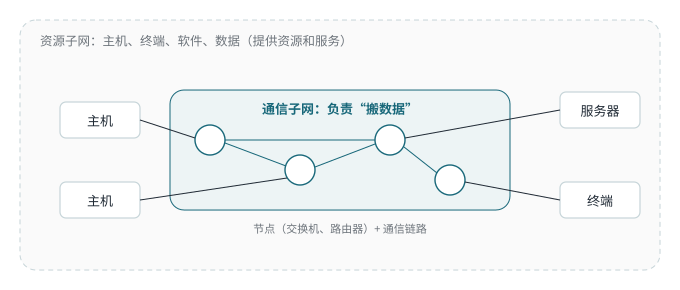

<!-- 计算机网络 / 第 1 章 计算机网络的基本概念 -->
# 第 1 课　网络的分类、组成与通信方式

> 2026-09-14（周一）· 理论课 · 教材 1.1–1.2

> **导读**
> 第一节课建立几个最基础的框架：网络按覆盖范围怎么分、网络由哪两部分组成、点到点和对等这两个容易混的概念。

## 一、按覆盖范围分类

| 类型 | 英文 | 范围 | 例子 |
|---|---|---|---|
| 局域网 | LAN | 一栋楼、一个校园（几米到几千米） | 宿舍网、机房 |
| 城域网 | MAN | 一座城市（几十千米） | 城市宽带汇聚网 |
| 广域网 | WAN | 跨城市、跨国家（几百到几千千米） | 运营商骨干网、互联网 |

> **工程现实**
> “跑在公网上的 VPN”按覆盖范围看可以跨国，但它是叠加在别人网络之上的**逻辑网络（overlay）**，不能简单归为 LAN、MAN 或 WAN 中的某一类。

## 二、资源子网与通信子网

*图 1-1　资源子网包围着通信子网*

| | 资源子网 | 通信子网 |
|---|---|---|
| 组成 | 主机、终端、外设、软件、数据 | 通信节点（交换机、路由器等）+ 通信链路 |
| 作用 | **提供资源和服务**，处理数据 | **负责传输数据**（“搬数据”） |

> **考试主线**
> 判断题看一个设备是**提供/使用资源**还是**转发数据**：主机、服务器属于**资源子网**；交换机、路由器、链路属于**通信子网**。

## 三、基本概念

- **1 Byte = 8 bit**。速率单位用 bit/s（小写 b），存储容量常用 Byte（大写 B）：100 Mbit/s 的宽带下载速度约 12.5 MB/s
- **单播**：一对一；**广播**：一对所有；（组播：一对一组）
- **ATM**：异步传输模式，用 53 字节固定长度信元传输，第 2 课细讲

## 四、点到点与对等：两个容易混的词

| | Point-to-Point 点到点 | Peer-to-Peer 对等 |
|---|---|---|
| 描述什么 | **连接形态**：一条链路只连两个端点 | **通信双方的地位**：没有主从，彼此平等 |
| 反义 | 广播式 / 多点共享介质 | 客户机/服务器（C/S） |
| 例子 | 两台路由器之间的串口专线、PPP 链路 | BT 下载、两台路由器之间建立的 BGP 对等体 |

> **易错点**
> 两个词都缩写成 P2P，但说的是**不同维度**：一个讲“线怎么连”，一个讲“谁和谁平等”。课上有老师用“LAN 类比 AS（自治系统），网络之间是 peer-to-peer”来解释，这其实是第 12 课 BGP 里“AS 之间互为对等体”的意思。

> **联系实际**
> WireGuard 里每个节点都叫 peer：它们地位平等（对等），每两个 peer 之间形成一条逻辑上的点到点隧道。它是建在公网之上的三层 overlay，不属于“城域网”这种按范围的分类。

## 五、本课小结

1. 按范围：LAN < MAN < WAN
2. 网络 = 资源子网（提供资源） + 通信子网（传输数据）
3. 点到点说连接形态，对等说地位关系
