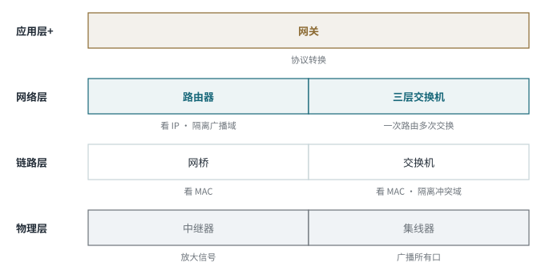

<!-- 计算机网络 / 第 4 章 局域网技术 -->
# 第 10 课　千兆与万兆以太网、网络互联设备

> 2026-10-28（周三晚）· 理论课 · 教材 4.2、4.3 网络互联

## 一、千兆以太网（Gigabit Ethernet）

| 标准 | 介质 | 波长 | 距离 |
|---|---|---|---|
| 1000BASE-T（802.3ab） | 铜缆 Cat5e / Cat6 | — | 100 m |
| 1000BASE-SX（802.3z） | **多模**光纤 | 850 nm | 几百米 |
| 1000BASE-LX（802.3z） | 单模 / 多模光纤 | 1310 nm | 比 SX 远（单模可达数千米） |

- 帧格式与传统以太网兼容
- 标准里有**半双工（用 CSMA/CD）**和**全双工（不用）**两种方式

> **工程现实**
> 千兆半双工基本只存在于标准文本里，实际几乎都是交换式全双工。

## 二、再看单模与多模

| | 单模 | 多模 |
|---|---|---|
| 芯径 | 约 9 μm | 50 / 62.5 μm |
| 常用波长 | 1310 / 1550 nm | 850 nm |
| 距离 | 远 | 近 |
| 模间色散 | 小 | 明显 |
| 对应标准 | LX、LR、ER | SX、SR |

> **记忆口诀**
> S = Short（短距，多模），L = Long（长距），E = Extended（更远）。

## 三、万兆以太网（10GbE）

| 标准 | 内容 |
|---|---|
| 802.3ae | 光纤 10GbE |
| 802.3an | 10GBASE-T（双绞线，100 m） |
| 802.3ap | 背板以太网 |

| 物理层 | 距离 |
|---|---|
| 10GBASE-SR | 几百米（看光纤类型） |
| 10GBASE-LR | 约 10 km |
| 10GBASE-ER | 约 40 km |
| 10GBASE-CX4 | 约 15 m（铜缆） |
| 10GBASE-T | 100 m（双绞线） |

- **只工作在全双工方式，不再使用 CSMA/CD**
- LAN PHY 速率 10 Gbit/s；WAN PHY 约 9.59 Gbit/s，是为了适配 SONET/SDH 广域网

> **易错点**
> 课堂语音转写出现过“13 cm / 10 cm / 40 cm”，根据课件应为 SR 几百米、**LR 10 km、ER 40 km**。

## 四、40G / 100G 以太网

40GbE：KR4、CR4、SR4、LR4；100GbE：CR10、SR10、LR4、ER4。

> **考试主线**
> 老师明确说：40G / 100G 的这些具体型号**了解即可，不要求记**。

## 五、以太网拓扑的演变

- 早期：**同轴电缆总线**
- 10BASE-T 起：**物理星型**
- **Hub**：物理星型，逻辑上仍共享介质，**整个是一个冲突域**
- **交换机**：物理星型，端口独立转发，全双工下**没有冲突**
- 更大的网络整体呈**树型或混合型**（接入层是星型）

## 六、网络互联（4.3）

### 1. 透明网桥与源路由网桥

| | 透明网桥 | 源路由网桥 |
|---|---|---|
| 谁决定路径 | **网桥自己**：学习 MAC 地址和端口的对应关系，按 MAC 表转发 | **源主机**：把路由信息写进帧里 |
| 主机是否感知 | 感知不到网桥的存在 | 需要主机参与 |
| 常用于 | 以太网 | 令牌环 |

> **记忆口诀**
> 透明网桥“网桥自己找路”，源路由网桥“源主机指定路”。

### 2. Hub 与交换机

| | 集线器 Hub | 交换机 Switch |
|---|---|---|
| 层次 | **物理层** | **数据链路层** |
| 转发方式 | 收到信号转发到**所有其他端口** | 学习 MAC，按**目的 MAC** 只转发到对应端口 |
| 冲突域 | 所有端口**一个冲突域** | **每个端口一个冲突域** |
| 带宽 | 共享 | 每端口独享 |
| 双工 | 半双工，用 CSMA/CD | 支持全双工 |
| 比喻 | **大喇叭** | **快递分拣员** |

*图 10-1　互联设备与所在层次（第 12 课会补全路由器和网关）*

> **考试主线**
> Hub 什么都不隔离；**网桥、交换机隔离冲突域**；**路由器隔离广播域**。这一点在第 13 课实验里亲眼验证过。

## 七、本课小结

1. 1000BASE-T / SX / LX；802.3z、802.3ab
2. 10GbE 只有全双工；SR / LR / ER 距离
3. 40G / 100G 型号了解即可
4. 透明网桥自己学 MAC；Hub 广播、交换机按 MAC 转发
