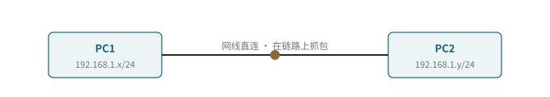
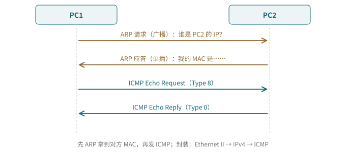

<!-- 计算机网络 / 实践课 -->
# 第 11 课　实践：网络命令、eNSP 直连与 Wireshark 抓包

> 2026-10-29（周四）· 实践课（D404 实验室）· 对应教材 2.5 华为 eNSP 的安装和使用实践

> **导读**
> 实验环境：Windows 7、eNSP、WinPcap、Wireshark、VirtualBox。先用 Windows 自带的网络命令，再在 eNSP 里搭两台 PC 直连，用 Wireshark 看 ARP 和 ICMP。

## 一、Windows 网络命令与 Linux / macOS 对照

| 用途 | Windows | Linux | macOS |
|---|---|---|---|
| 测连通 | `ping baidu.com`（默认发 **4 个**） | `ping -c 4 baidu.com` | 同 Linux（默认一直发，Ctrl+C 停） |
| 看地址 | `ipconfig /all` | `ip addr` | `ifconfig` |
| 看路由表 | `route print` | `ip route` | `netstat -rn` |
| 看 ARP 表 | `arp -a` | `ip neigh` | `arp -a` |
| 看连接和监听端口 | `netstat -a` / `netstat -ano` | `ss -tulpn` | `netstat -an`、`sudo lsof -nP -iTCP -sTCP:LISTEN` |
| 路径追踪 | `tracert` | `traceroute`、`mtr` | `traceroute`、`mtr` |
| 清屏 | `cls` | `clear` | `clear` |

> **易错点**
> 发送次数参数：Windows 是 `-n`，Linux / macOS 是 `-c`；在 macOS 上写 `ping -n 3` 会报参数错误。macOS 默认**没有** `ss`，那是 Linux iproute2 的命令。

### tracert 与 mtr

- `tracert` / `traceroute`：利用 TTL 递增，**单次**显示到目的地经过的每一跳
- `mtr`：持续 traceroute，并统计每一跳的**丢包、RTT、抖动**

> **工程现实**
> 看 mtr 时，**中间某一跳丢包很高、但后面各跳和终点都是 0% 丢包**，一般是那台路由器对 ICMP 超时报文**限速**（控制平面优先级低），不是真的丢包。真正有问题时，丢包会从某一跳开始**一直延续到终点**。另外：BGP 选路看策略不看地理距离，同一目的地从不同出发点可能走完全不同的运营商。

## 二、eNSP：两台 PC 直连

*图 11-1　实验拓扑：PC1 与 PC2 用网线直连，在链路上抓包*

步骤：

1. 拖两台 PC，用网线连接，启动设备
2. 在 PC 的“基础配置”里配**同一网段**的 IP 和掩码，点“应用”
3. 打开 PC 自带的“命令行”，`ping` 对方
4. 右键链路（或端口）→ 开始抓包，打开 Wireshark 观察

## 三、Wireshark 看到了什么

*图 11-2　第一次 ping 的报文顺序*

1. **ARP 请求（广播）**：目的 MAC `ff:ff:ff:ff:ff:ff`，“谁是 PC2 的 IP？请告诉 PC1”
2. **ARP 应答（单播）**：PC2 把自己的 MAC 回给 PC1
3. **ICMP Echo Request（Type 8）** → **Echo Reply（Type 0）**，来回几次

展开一个 ICMP 包，层次正好是封装：**Frame → Ethernet II → IPv4 → ICMP**。

> **考试主线**
> 同一网段通信前必须先用 **ARP** 把对方 IP 解析成 MAC，才能封装出以太网帧。ICMP Echo Request 是 **Type 8**，Echo Reply 是 **Type 0**；ping 不走 TCP/UDP。

> **补充**
> 在云服务器上用 `tcpdump -e` 抓 ARP，有时会看到目的 MAC 直接是本机的**单播 ARP 请求**（不是广播），这是网关在确认缓存里的地址还有效，属于正常现象。

## 四、本课小结

1. ping、netstat、tracert、cls 及对应的 Linux / macOS 命令
2. mtr 中间跳丢包、终点不丢 → 多半是 ICMP 限速
3. eNSP 直连：同网段 IP → ping → 抓包
4. ARP 广播请求、单播应答，然后 ICMP Type 8 / Type 0
