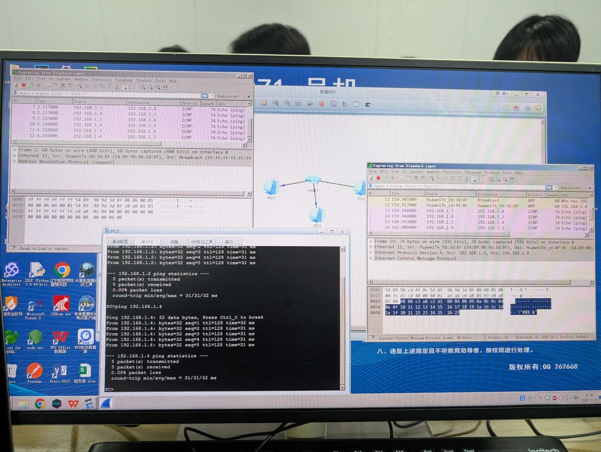
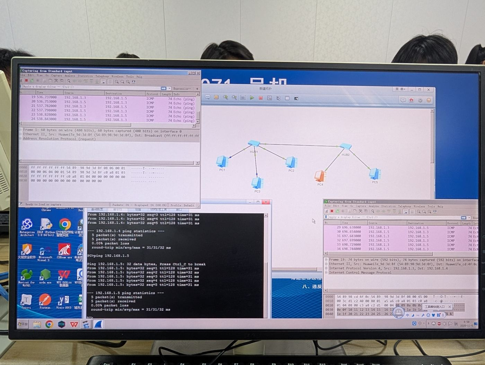
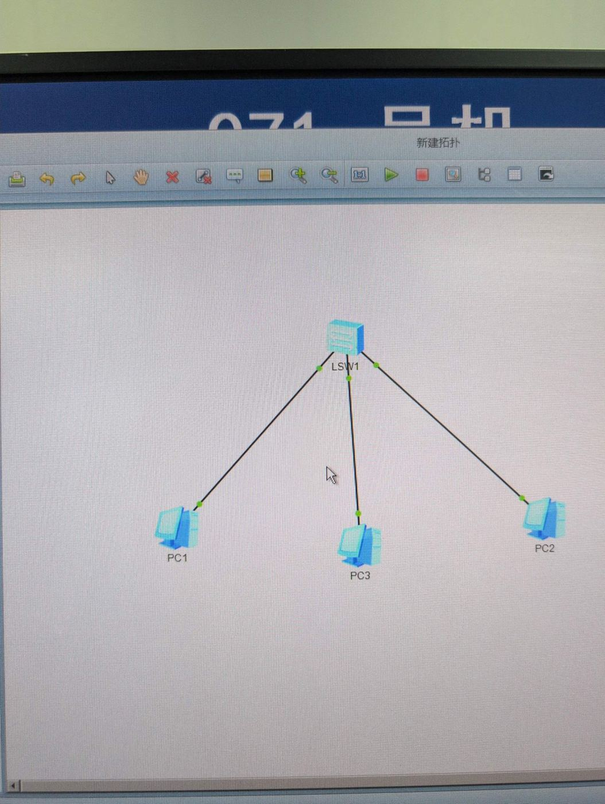
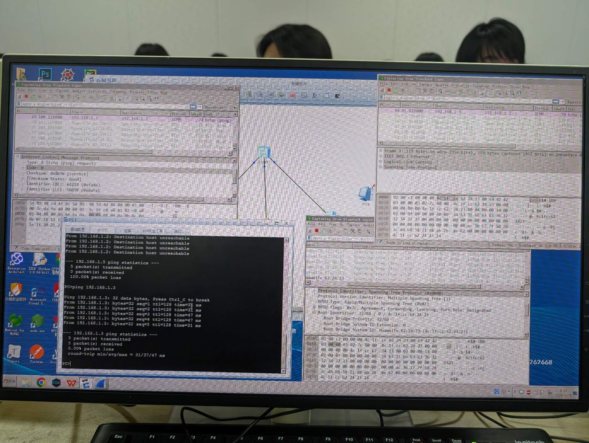
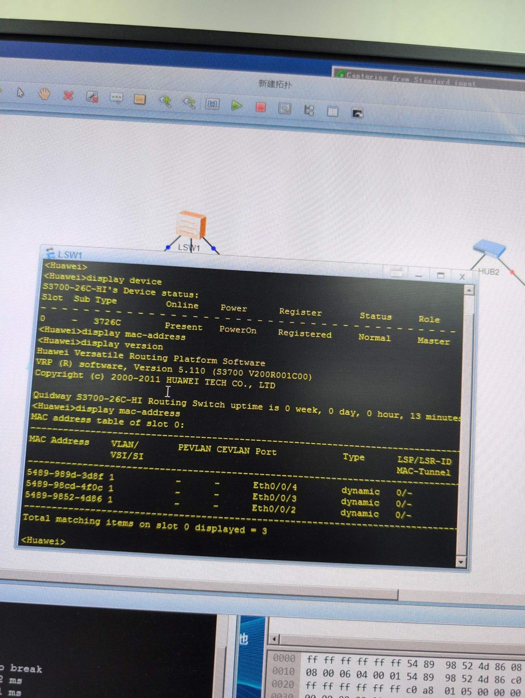

<!-- 计算机网络 / 实践课 -->
# 第 13 课　实践：集线器组网与交换机 MAC 地址学习

> 2026-11-05（周四）· 实践课（D404 实验室）· 对应教材 3.5 交换机配置实践、4.3 网络互联

> **导读**
> 同样三台 PC，先用集线器连，再换成交换机，在“第三台 PC”的链路上抓包，看它能不能看到别人的通信。这个实验把第 10 课“Hub 是大喇叭、交换机是快递分拣员”变成了亲眼所见。

## 一、实验一：集线器（Hub）

拓扑：HUB1 连 PC1、PC2、PC3，三台 PC 配 `192.168.1.0/24` 网段地址；再把 HUB1 和 HUB2 级联，接上 PC4、PC5。



*图 13-1　一台 Hub：两个不同链路上的抓包窗口都看到了 .3 ↔ .4 的 ICMP*

观察：

- 两个 Wireshark 窗口抓的是**不同的线**，都看到了 192.168.1.3 ↔ 192.168.1.4 的 ping，其中一个抓包点所在的 PC 根本不是通信方
- 第 1 帧是 **ARP 广播**（目的 `ff:ff:ff:ff:ff:ff`）；之后的 **ARP 应答是单播**，旁边端口照样抓到了 → **Hub 根本不看 MAC 地址**



*图 13-2　两台 Hub 级联：跨过两台 Hub 的 .3 → .5，两边都能抓到*

> **考试主线**
> Hub 工作在**物理层**，不识别地址，把信号转发到**所有端口**；级联后仍是**一个冲突域、一个广播域**。经典以太网用 **5-4-3 规则**限制级联：最多 5 个网段、4 个中继器或 Hub、其中 3 个网段可以接主机。

## 二、实验二：交换机

拓扑：LSW1（S3700）连 PC1、PC2、PC3。



*图 13-3　交换机拓扑：链路两端都是绿点，说明链路已 UP*



*图 13-4　PC1 ping PC3 时，PC2 那条链路上只有 STP 报文，看不到 ICMP*

观察：

- PC1（.2）ping PC3（.3）通了；但**右下角 PC2 链路的抓包只有 STP，没有 ICMP** → 交换机已经学到 MAC，**单播只转发到目的端口**
- ping 一个**不存在的地址**（.5）时显示 *Destination host unreachable*：ARP 广播没人应答，拿不到 MAC，ICMP 根本发不出去，由本机报不可达
- 抓包里大量 **STP（生成树）BPDU**：交换机每 2 秒自动发，用于防止环路，华为默认 MSTP 模式；BPDU 是 **IEEE 802.3 + LLC** 封装，目的 MAC 是组播 `01:80:c2:00:00:00`（平时的 IP 包都是 Ethernet II，难得见到 LLC 帧）

> **易错点**
> 交换机端口刚 UP 时，STP 要经过监听、学习状态，约 **30 秒**后才转发，这期间 ping 不通是正常的，不是配置错误。Wireshark 里输入过滤 `icmp || arp` 可以把 STP 报文藏起来。

## 三、查看 MAC 地址表

```
<Huawei> display device          # 硬件 / 板卡状态（Present、PowerOn、Registered、Normal）
<Huawei> display version         # 系统版本、运行时间
<Huawei> display mac-address     # MAC 地址表
<Huawei> display interface brief # 端口 UP / DOWN 一览
<Huawei> display stp brief       # 各端口 STP 角色和状态
```

第一次执行 `display mac-address` 时**表是空的**：MAC 表项默认 **300 秒老化**，上次 ping 已经过去 5 分钟以上。重新 ping 一次再查：



*图 13-5　重新 ping 后，交换机学到 3 条 dynamic 表项*

| MAC 地址 | VLAN | 端口 | 类型 |
|---|---|---|---|
| 5489-989d-3d8f | 1 | Eth0/0/4 | dynamic |
| 5489-98cd-4f0c | 1 | Eth0/0/3 | dynamic |
| 5489-9852-4d86 | 1 | Eth0/0/2 | dynamic |

- **dynamic**：通过**自学习**得到——交换机看收到帧的**源 MAC**，记下“这个 MAC 在这个端口后面”
- **VLAN 1**：所有端口默认在 VLAN 1，整台交换机是一个广播域
- `5489-9852-4d86` 和 Wireshark 里的 `54:89:98:52:4d:86` 是同一个地址；前缀 54:89:98 是华为的厂商标识（OUI）
- 交换机自己发的 BPDU 不会被记进 MAC 表

> **考试主线**
> 交换机转发三件事：**学习**（记源 MAC）、**转发/过滤**（目的 MAC 在表里就只发对应端口）、**泛洪**（广播、未知单播发往所有其他端口）。表项会**老化**，主机换了位置也能重新学到。

## 四、Hub 与交换机对比（实验结论）

| | Hub | 交换机 |
|---|---|---|
| 第三台 PC 能否看到别人的单播 | **能** | **不能** |
| ARP 广播 | 所有端口都收到 | 也泛洪到所有端口 |
| 有没有地址表 | 没有 | MAC 地址表，自学习 + 老化 |
| 冲突域 | 全部端口一个 | 每端口一个 |
| 广播域 | 一个 | 一个（要分隔需 VLAN 或路由器） |

> **联系实际**
> Linux 网桥做的是同一件事：`bridge fdb show` 就是它的 MAC 表，默认老化时间也是 300 秒；Docker 的 `docker0` 就是一台软件交换机。

## 五、本课小结

1. Hub：物理层、广播转发，旁路端口能看到别人的单播
2. 交换机：自学习源 MAC、按目的 MAC 转发、广播泛洪、表项 300 s 老化
3. `display mac-address`、`display device` 等常用命令
4. STP BPDU 是正常报文，端口刚 UP 约 30 s 才转发
