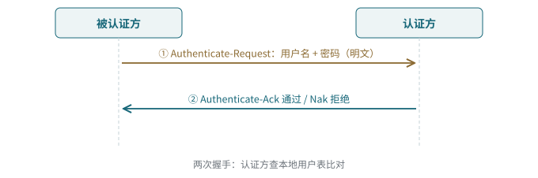
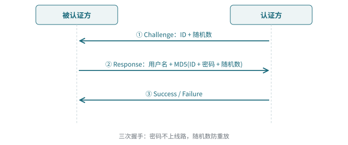
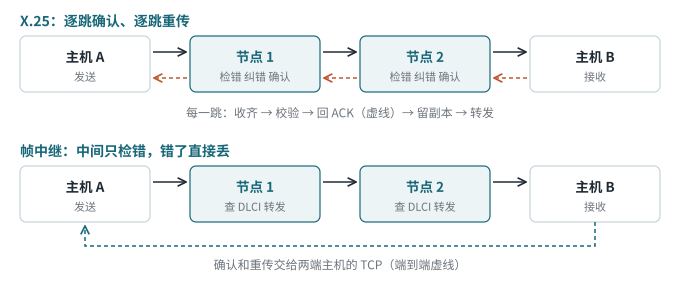
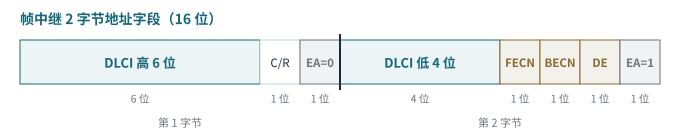
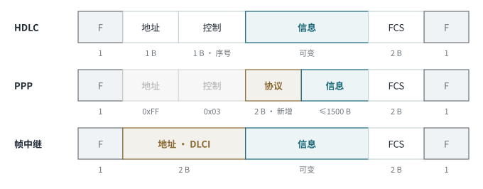

<!-- 计算机网络 / 第 5 章 广域网技术 -->
# 第 14 课　HDLC、PPP 与帧中继

> 2026-11-11（周三）· 理论课 · 教材 5.2 HDLC 协议、5.3 PPP、5.4 FR 协议

> **导读**
> 物理层只会把 0 和 1 送过去，链路层负责把比特流切成帧、找到边界、检查错误。本课学广域网数据链路层的“三兄弟”：可靠但封闭的 HDLC、今天仍在大量使用的 PPP、以及把纠错甩给终端换取速度的帧中继。

## 一、为什么需要链路层协议

没有链路层，接收方收到的只是一串无穷无尽的 0/1，**不知道帧从哪开始、到哪结束，也不知道传错了没有**。链路层要解决：

| 功能 | 解决的问题 | HDLC 的做法 |
|---|---|---|
| 成帧 | 找到边界 | 帧首尾各放一个标志 `01111110` |
| 寻址 | 发给谁 | 地址字段 |
| 差错控制 | 传错了怎么办 | FCS（CRC）检错 + 序号确认重传 |
| 流量控制 | 发太快对方收不过来 | 控制字段里的序号、滑动窗口 |

## 二、HDLC（高级数据链路控制）

### 1. 特点

- **面向比特**：按比特定界，**不依赖任何字符编码集**（早期面向字符的协议要用 STX、ETX 等特殊字符定界）
- **透明传输**：用 **0 比特填充**，任何比特组合都能传；规则简单，**易于硬件实现**
- **全双工**，用**滑动窗口**做流量控制：不必每帧停下来等确认。3 位序号时发送窗口最大 7，扩展模式 7 位序号时最大 127
- **CRC 校验**，检错能力强
- **控制与数据分离**：控制信息集中在固定位置的控制字段，处理时不必翻看数据

### 2. 帧格式


*图 14-1　HDLC 帧格式：F A C I FCS F*

| 字段 | 长度 | 说明 |
|---|---|---|
| 标志 F | 1 B | `01111110`（0x7E），首尾各一个；连续发送时前一帧的结束标志可兼作后一帧的开始 |
| 地址 A | 1 B | 从站（次站）地址；**全 1 为广播**，**全 0 为无效地址** |
| 控制 C | 1 B | 帧类型 + 序号：**0 开头是 I 帧**（信息），**10 是 S 帧**（监控），**11 是 U 帧**（无编号） |
| 信息 I | 可变 | 上层数据；S 帧没有信息字段 |
| FCS | 2 B | CRC-16（也可 32 位），校验范围是 **A、C、I**，不含标志 |

> **记忆口诀**
> 帧格式 **F-A-C-I-FCS-F**，别漏了最后那个 F；控制字段 **0 是 I，10 是 S，11 是 U**（信息、监控、无编号）。

### 3. 0 比特填充（透明传输）

问题：数据里如果正好出现 `01111110`，接收方会以为帧结束了。

- **发送端**：在两个标志之间的内容里，**每遇到连续 5 个 1，就插入一个 0**
- **接收端**：每数到连续 5 个 1，看第 6 位：是 0 → 删掉；是 1 且第 7 位是 0 → 这是标志；连续 7 个以上的 1 → 出错或中止


*图 14-2　0 比特填充例题：原始 15 位，填充后 17 位*

> **易错点**
> ① 连续 5 个 1 **就插**，不管第 6 位本来是 0 还是 1（上图第二处就是原数据 `11111` 后面本来就是 0，照样插）；② 插入 0 之后**重新开始计数**；③ 标志本身不填充。

## 三、PPP（点对点协议）

### 1. 定位

| 项目 | 内容 |
|---|---|
| 层次 | 第二层（数据链路层），在 TCP/IP 里属于网络接口层，为 IP 提供服务 |
| 工作方式 | 点对点、全双工、**按顺序**传输（两点之间只有一条路，不会乱序） |
| 典型场景 | 路由器之间的**串口专线**；宽带拨号 **PPPoE** |

### 2. 三大组成

| 组成 | 管什么 | 协商内容 |
|---|---|---|
| **封装** | 怎么把数据装进帧 | 帧格式，用协议字段区分载荷 |
| **LCP** 链路控制协议 | 链路本身 | MRU、**要不要认证、用 PAP 还是 CHAP**、魔术字（检测自环）、链路质量 |
| **NCP** 网络控制协议 | 网络层 | IP 用 **IPCP**：分配 IP 地址、DNS、头部压缩 |

> **考试主线**
> 顺序是 **先 LCP → 再认证 → 最后 NCP**：先修路，再查证件，最后发门牌号。LCP 不成功，后面都不会开始；认证不通过，拿不到 IP。

### 3. 六个优点

**双模**（同步、异步线路都能用）、**扩展**（多链路捆绑 MP、PPPoE）、**LCP**（自动协商与链路检测）、**NCP**（支持多种网络层协议、动态分配 IP）、**认证**（PAP / CHAP）、**高效**（帧头小，可压缩地址、控制、协议字段）。

> **补充**
> PPP **不重传不是缺点，是设计取舍**：现代线路误码率低，逐跳重传白白浪费时间；端到端的可靠性统一交给 TCP（端到端原则）。例外是 Wi-Fi：无线出错率高，所以 802.11 在链路层有确认和重传。

### 4. 帧格式：从 HDLC 改来

| 字段 | 长度 | 值 | 为什么 |
|---|---|---|---|
| 标志 | 1 B | 0x7E | 沿用 HDLC |
| 地址 | 1 B | **0xFF 固定** | 点对点只有一个对端，不用选地址 |
| 控制 | 1 B | **0x03 固定** | UI 帧（无编号），不做序号确认 |
| **协议** | **2 B** | 见下表 | **新增**，标识载荷是什么 |
| 信息 | ≤1500 B | — | 默认 MRU 1500，由 LCP 协商 |
| FCS | 2 B | — | CRC 检错，出错丢弃不重传 |
| 标志 | 1 B | 0x7E | 帧结束 |

| 协议字段 | 载荷 | 规律 |
|---|---|---|
| 0xC021 | LCP | **C 开头 = 链路层自己的控制** |
| 0xC023 / 0xC223 | PAP / CHAP | 〃 |
| 0x8021 | IPCP | **8 开头 = NCP** |
| 0x0021 | IP 数据报 | **0 开头 = 网络层数据** |

> **易错点**
> PPP 帧除信息字段外共 **1+1+1+2+2+1 = 8 字节**，比 HDLC 多的 2 字节就是协议字段。PPPoE 再加 6 字节头部，所以宽带拨号 MTU 是 **1492**。

### 5. 五个阶段


*图 14-3　PPP 链路建立的五个阶段*

- 物理层 UP → 进入 Establish；LCP 协商失败 → 回到 Dead
- **认证可以没有**：LCP 没要求认证就直接进 Network
- **认证失败 → Terminate**，不会进 Network
- NCP 协商成功后才开始传 IP 包；华为 `display interface Serial0/0/0` 看到 `LCP opened, IPCP opened` 表示链路正常

### 6. PAP 与 CHAP



*图 14-4　PAP 两次握手*



*图 14-5　CHAP 三次握手*

| 对比项 | PAP | CHAP |
|---|---|---|
| 握手次数 | 两次 | 三次 |
| 密码传输 | **明文** | 不传密码，只传 **MD5 摘要** |
| 谁发起 | 被认证方 | 认证方（发挑战） |
| 安全性 | 低：可被窃听、可反复试密码 | 高：随机数**防重放** |
| 认证时机 | 只在建链时一次 | 建链时 + 可**周期性重新认证** |
| 适用 | 安全要求低 | 安全要求高，一般优先 |

- **单向认证**：只有一端验证另一端（运营商验证宽带账号）；**双向认证**：两端互相验证
- 不做认证的后果：任何人把这根线插到自己的设备上就能冒用

> **记忆口诀**
> PAP = **报口令进门**；CHAP = **对暗号进门**。

> **工程现实**
> CHAP 是“挑战—应答”思路的共享密钥版本。TLS 证书、SSH 公钥登录用的是非对称版本：服务器发随机数，对方用私钥签名、服务器用公钥验证，服务器那边不需要保存任何能登录的秘密。

华为 eNSP 配置参考（CHAP，单向）：

```
# 认证方
aaa
 local-user user1 password cipher 123456
 local-user user1 service-type ppp
interface Serial0/0/0
 link-protocol ppp
 ppp authentication-mode chap

# 被认证方
interface Serial0/0/0
 link-protocol ppp
 ppp chap user user1
 ppp chap password cipher 123456
```

## 四、FR（帧中继）

### 1. 是什么

在 X.25 基础上改进的**快速分组交换**技术：只实现**物理层和数据链路层核心功能**，把流量控制、差错控制交给**智能终端**，简化节点间协议，缩短处理时间。

能这样做的两个前提：**线路质量变好**（光纤、数字线路误码率低）、**终端变聪明**（两端有 TCP 负责重传）。

### 2. 为什么快：不是跑得更快，是做得更少



*图 14-6　X.25 逐跳确认 vs 帧中继端到端确认*

| 对比项 | 普通分组交换（X.25） | 帧中继 |
|---|---|---|
| 确认机制 | 逐跳确认 | 中间节点不确认，端到端确认 |
| 重传控制 | 逐跳重传 | 节点检错即丢，由上层重传 |
| 传输时延 | 大 | 小 |
| 协议开销 | 大（三层） | 小（两层） |
| 面向连接 | 是，虚电路 | 是，虚电路 |
| 标识 | 逻辑信道号，第三层处理 | **DLCI**，第二层处理，**只有本地意义** |

压缩的是时延里的**处理时延**；传播时延（距离和光速决定）一点没变。

### 3. 虚电路

帧中继**面向连接**，DTE 之间建立的连接叫**虚电路**。“虚”在于：路径固定、按序到达，看起来像专线，但物理线路是**共享**的，有数据才占带宽，用 DLCI 区分不同的逻辑连接。

| | PVC 永久虚电路 | SVC 交换虚电路 |
|---|---|---|
| 建立 | 运营商预先配置 | 通信时动态建立，用完释放 |
| 建立时延 | 无，随时可用 | 每次都要先建 |
| 灵活性 | 低 | 高 |
| 适合 | 固定站点长期通信（总部—分公司） | 偶尔通信 |

实际上帧中继网络绝大多数用的是 **PVC**。

### 4. 特点

两层半（物理层 + 链路层，提供部分网络层功能，即按 DLCI 转发）、线路误码率低、PVC/SVC + **统计时分复用**（一个物理接口复用多条逻辑连接，减少入网端口）、流程简化、带宽按需（购买 **CIR 承诺信息速率**，突发时可超过）、改造成本低。

> **易错点**
> **统计时分复用**按需分配时隙，和第 3 课讲的**同步 TDM**（固定时隙，没数据也占着）不同。

### 5. 帧格式：没有控制字段

| 字段 | 长度 |
|---|---|
| 标志 F | 1 B |
| 地址 A | **2 B**（可扩展到 3、4 B） |
| 信息 I | 可变 |
| FCS | 2 B |
| 标志 F | 1 B |



*图 14-7　帧中继地址字段：10 位 DLCI + 拥塞控制位*

- **为什么没有控制字段**：不做流量控制和差错控制，没有序号，控制字段没有存在的必要；帧头更短，处理更快
- **FECN**：前向显式拥塞通知，告诉接收方；**BECN**：后向，告诉发送方慢一点；**DE**：超出 CIR 的帧置 1，拥塞时优先丢

> **考试主线**
> 帧中继帧与 HDLC 帧相比，**最大的区别是没有控制字段**；地址字段扩展为 2 字节，包含 10 位 DLCI 和 FECN、BECN、DE。

## 五、三兄弟对比



*图 14-8　HDLC、PPP、帧中继帧格式对比*

| 对比项 | HDLC | PPP | 帧中继 |
|---|---|---|---|
| 连接 | 点对点 / 点对多点 | 只有点对点 | 多条虚电路连多点 |
| 寻址 | 地址 A | 固定 0xFF | DLCI |
| 差错控制 | 检错 + 重传 | 只检错 | 只检错 |
| 身份认证 | 无 | **PAP / CHAP** | 无 |
| 多协议 | 标准版无协议字段，厂商不兼容 | **协议字段 + NCP** | 支持 |
| 动态 IP | 不支持 | **IPCP** | 不支持 |
| 现状 | 少见 | **广泛使用**（含 PPPoE） | 基本淘汰 |

> **考试主线**
> PPP 占绝对优势：有认证、多协议、能动态分配 IP、开放标准可互通、能跑在以太网上（PPPoE）。

> **工程现实**
> 帧中继已被 MPLS 取代，但“虚电路 + 只在本地有意义的标签”这个思想被 MPLS 继承了；交换机的 VLAN 标签也是用一个小号码在共享线路上区分逻辑网络。

## 六、随堂题

1. 广域网的通信子网主要使用分组交换技术。（**正确**；“只能用分组交换”就是错的）
2. DTE 和 DCE 谁提供时钟？（**DCE**，谁提供时钟谁就是 DCE）
3. 帧中继与 HDLC 相比最大的区别？（**没有控制字段**）
4. 写出 `011111101111101` 经 0 比特填充后的结果。（`01111101011111001`）
