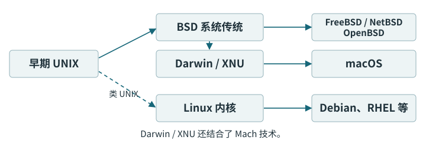
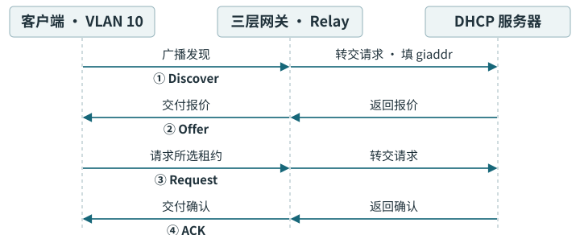
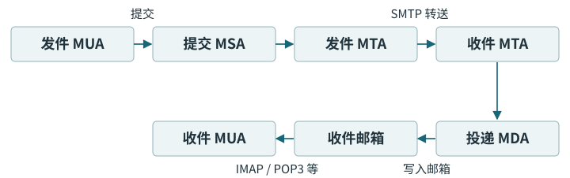

<!-- 计算机网络 / 第 6 章 网络操作系统与网络服务 -->
# 第 15 课　网络操作系统与网络服务

> 2026-11-16（周一）· 理论课 · 第六章《网络操作系统与网络服务》

> **导读**  
> 前面几课讲数据怎样经过交换机和路由器。本课往上看：操作系统怎样管理联网资源，客户端又怎样拿到地址、解析域名、访问网页、共享文件和发送邮件。

<!-- PAGE: 操作系统与网络操作系统 -->
## 一、上节回顾：广域网与链路协议

- 课堂回顾的广域网通信子网以**分组交换**为主。接入方式可包括专线与交换连接。
- DTE 是**数据终端设备**，DCE 是**数据电路终接设备**。在传统同步串行线路中，DCE 通常提供时钟。
- **HDLC** 面向比特，使用零比特填充。**PPP** 由封装、LCP、NCP 组成。
- 课堂对照的典型帧中继帧中，没有 HDLC 那种独立的控制字段。详见[第 14 课](https://github.com/realLeoKnox/study/blob/main/lncm/network/class14/class14.md)。

## 二、操作系统与网络操作系统

| 基本功能 | 管什么 |
|---|---|
| 处理器管理 | 进程与线程调度，分配 CPU 时间 |
| 存储管理 | 分配和保护内存，管理虚拟内存 |
| 设备管理 | 驱动、输入输出与设备分配 |
| 文件管理 | 文件与目录组织、存取和访问控制 |
| 接口管理 | 提供系统调用，以及命令行、图形界面等使用入口 |

**网络操作系统**在本机资源管理之上，强调网络通信、资源共享、用户认证和权限管理。现代通用操作系统通常也提供这些能力。

| 教材分类 | 关注点 |
|---|---|
| 批处理 | 自动批量执行作业，重视吞吐量 |
| 分时 | 多用户或多任务交互，调度可采用时间片 |
| 实时 | 在规定期限内完成响应或处理 |
| 网络 | 各台计算机保持相对独立，通过网络共享资源 |
| 分布式 | 协调多台机器，尽可能提供统一资源视图与位置透明性 |

> **课堂类比**  
> 网络操作系统像物业管理处，DHCP 像分配房号，DNS 像按名字查通讯录。考试问网络 OS 与分布式 OS，先写**共享资源**，再写**统一视图与透明性**。

<!-- PAGE: UNIX、Linux 与 BSD -->
## 三、常见操作系统与 BSD

课上涉及 UNIX、Linux、Windows、BSD，以及早期的 MS-DOS、Windows 95。读谱系图时注意区分**历史来源、兼容接口、发行版关系**三种连线。

*图 15-1　操作系统关系示意。实线表示历史来源或上层系统关系，虚线表示接口与设计传统；未展开各分支的完整历史。*

- **Linux** 是独立发展的类 UNIX 内核。Ubuntu 基于 Debian。RHEL、历史上的 CentOS Linux 和 CentOS Stream 同属 Red Hat 相关生态，CentOS Stream 位于后续 RHEL 发行流程的上游。
- **macOS** 的 Darwin/XNU 使用 Mach 和 BSD 技术。UNIX 认证应按获得认证的具体产品与版本表述。

| BSD 系统 | 课堂涉及 | 课外阅读线索 |
|---|---|---|
| FreeBSD | 网络栈、服务器应用、硬件支持、Ports 与部分 Linux 程序兼容 | `pkg` 装二进制包，Ports 提供构建配方。Linuxulator 提供部分 Linux 用户态兼容，Jails 用于系统级隔离 |
| NetBSD | 可移植性、代码质量、内存保护、存储与虚拟化、pkgsrc | ASLR、W^X、PaX 相关保护和 NVMM。pkgsrc 也可用于其他受支持的平台 |
| OpenBSD | 安全审计、开放源码、偏好宽松许可证，通常约半年发布一版 | `pledge()` 约束进程可用操作，`unveil()` 约束可见路径。另可关注 OpenSSH 与 `pf` |

> **联系实际**  
> 选服务器系统时，可用网卡驱动、软件包、升级维护、隔离方式和实际负载逐项比较。个人实践想法是用 FreeBSD VM 试做反向代理，对照现有 Debian LXC 方案，状态为待验证。

> **课外延伸**  
> Amoeba、Plan 9、Sprite、Inferno 可作为分布式系统的阅读线索。Kubernetes 在已有操作系统之上编排容器工作负载，比较时要交代它所在的抽象层。

<!-- PAGE: 应用层、DHCP 与 DNS -->
## 四、网络服务与应用层

TCP/IP 应用层容纳 Web、邮件、网络文件共享、远程桌面等服务协议，功能上也涵盖 OSI 表示层、会话层的部分职责。下面按“先能上网，再找到服务，最后使用服务”的顺序复习。

### 1. DHCP 与 DHCP Relay

DHCP 可自动分配 IPv4 地址并提供租期、子网掩码、默认网关和 DNS 等参数。DHCPv4 通常使用 **UDP 67（服务器）和 68（客户端）**。初次租约常见四步是 **Discover → Offer → Request → ACK**。

*图 15-2　典型 DHCPv4 中继。中继将客户端所在网段的信息带给服务器，再把响应交回客户端所在链路。*

> **易错点**  
> 客户端所在链路的广播通常不会被路由器直接转发。DHCP Relay 是专门的中继功能，服务器通常根据 `giaddr` 识别客户端所在网段，并从相应地址池分配地址。图示为首次租约，续租流程可能不同。

### 2. DNS（复习补充）

DNS 是分布式命名系统。客户端通常把查询交给**递归解析器**，后者优先查缓存，必要时按根、顶级域、权威服务器的委派关系取答案。TTL 控制记录可缓存多久。

| 记录 | 回答什么 |
|---|---|
| A / AAAA | 名称对应的 IPv4 / IPv6 地址 |
| CNAME | 此名称指向哪个规范名称 |
| MX | 哪些邮件服务器负责接收该域的邮件 |

传统 DNS 通常使用 **UDP 或 TCP 53**。普通查询常先走 UDP，收到截断响应后可用 TCP 重试。DHCP 可以告诉设备该问哪台解析器，DNS 负责回答名字相关的问题。

<!-- PAGE: Web 与文件传输 -->
### 3. WWW、HTTP 与 HTTPS

**WWW** 是 Web 资源体系，**HTTP** 定义客户端与服务器交换请求、响应的方式，**HTTPS** 用 TLS 保护 HTTP 通信。

| TLS 安全目标 | 在网页访问中解决的问题 |
|---|---|
| 机密性 | 通信内容难以被旁路窃听 |
| 完整性 | 可检测传输中的未授权修改 |
| 身份认证 | 客户端验证服务端身份，某些配置下也验证客户端 |

> **考试主线**  
> 随堂讨论涉及 HTTPS 的主要作用。答题时围绕机密性、完整性和服务端身份认证作答。附件保留了讨论主题，题干与选项未记录。

> **课外延伸 · HTTP/3 与后量子密钥交换**  
> HTTP/3 把 HTTP 映射到 QUIC。QUIC 运行在 UDP 上并使用 TLS 1.3，独立数据流可减少一个流丢包对其他流的阻塞，实际时延仍取决于路径与实现。链路带宽由链路条件决定。  
> ML-KEM-768 是后量子密钥封装机制的一组参数。X25519MLKEM768 将 X25519 与 ML-KEM-768 结合用于混合密钥建立。身份认证和签名属于另一组机制。

### 4. FTP、FTPS 与 SFTP

FTP 分开使用**控制连接**和**数据连接**。控制连接通常由客户端发起，连到服务端 **TCP 21**。

- **主动模式**：服务端发起数据连接，连到客户端指定的地址和端口，传统服务端常以 TCP 20 为源端口。
- **被动模式**：服务端告知监听端口，客户端发起数据连接。经过 NAT 或防火墙时，仍需考虑服务端被动端口范围。
- **工具角色**：vsftpd 是 FTP 服务端，FileZilla 有客户端和服务端产品。

| 名称 | 协议关系 | 常见识别方式 |
|---|---|---|
| FTP | 传统文件传输协议 | 控制连接 TCP 21 |
| FTPS | FTP 加 TLS | 显式 FTPS 通常从 TCP 21 开始，再协商 TLS |
| SFTP | SSH 文件传输子系统 | 常随 SSH 使用 TCP 22 |

<!-- PAGE: 网络文件共享与挂载 -->
### 5. SMB

SMB 提供网络文件共享和远程文件操作，也涉及访问权限、锁和并发协作。现代 SMB 常直接使用 **TCP 445**。课堂列了三类应用：

1. Hyper-V 使用 SMB 共享存放虚拟机文件。
2. SQL Server 在受支持的配置下使用 SMB 存储。
3. 普通用户共享文件与目录。

**工程补充**：SMB 3 系列支持加密、多通道等能力。SMB Direct 使用 RDMA，需要客户端、服务端及网络条件共同支持。

### 6. NFS 与 FUSE / rclone

NFS（Network File System）由 Sun Microsystems 开发，常用于 UNIX/Linux 环境。客户端可把服务端导出的目录挂载到本机，再通过路径访问远端文件。

| 名称 | 所在位置 | 读写路径 |
|---|---|---|
| NFS | 客户端与服务端之间的网络文件系统协议 | 应用 → 本地挂载点 → NFS 客户端 → 远端服务器 |
| FUSE | 操作系统与用户态文件系统程序的接口 | 应用 → 本地挂载点 → FUSE → 用户态程序 |
| rclone mount | 可通过 FUSE 挂载云存储的工具 | 应用 → FUSE → rclone → 云存储 API |

> **联系实际**  
> 看到挂载目录后，还要核对原子重命名、文件锁、随机写和持久化语义。数据库和虚拟机磁盘有各自的存储要求，对象存储挂载应按后端和缓存配置验证这些能力。

| 需求 | 首先想到 |
|---|---|
| 浏览网页或提供文件下载 | HTTP / HTTPS |
| 向远程主机传文件，已有 SSH | SFTP |
| 多人打开并协作使用共享目录 | SMB |
| UNIX/Linux 主机挂载远程导出目录 | NFS |
| 把云存储呈现为本机目录 | rclone mount / FUSE |

<!-- PAGE: SMTP 与本课小结 -->
### 7. SMTP 邮件服务

**SMTP** 负责提交和转送邮件。课堂讨论了 **MUA**（邮件用户代理）和 **MTA**（邮件传输代理）。下图同时补充 **MSA**（邮件提交代理）、**MDA**（邮件投递代理）。

*图 15-3　典型邮件路径。代理可以由同一套软件承担；取信或同步通常由 IMAP 或 POP3 完成。*

| SMTP 阶段 | 典型交互 |
|---|---|
| 建立会话 | 建立 TCP 连接、服务器问候、`EHLO` 或 `HELO` |
| 传输邮件 | `MAIL FROM` 指定信封发件人，`RCPT TO` 指定信封收件人，`DATA` 发送邮件内容 |
| 结束会话 | 发送 `QUIT`，关闭 SMTP 会话 |

> **易错点**  
> 服务器在 DATA 完成后确认接受，表示这台服务器已接手邮件。后续仍可能排队、重试或退信，最终投递到邮箱要看后续环节。

## 五、本课小结

1. **网络 OS**强调联网共享，**分布式 OS**强调统一管理和透明性。
2. **DHCP**发网络配置，**Relay**帮助跨网段，**DNS**查名称关联的记录。
3. **HTTPS**记机密性、完整性、认证。**FTP**记控制和数据双连接。
4. **SMB / NFS**提供网络文件访问。**FUSE**把用户态实现接到本机文件系统接口。
5. **SMTP**负责提交与转送，记住 **EHLO → MAIL FROM → RCPT TO → DATA → QUIT**。

> **自测（整理增补）**  
> 客户端换了 VLAN 后拿不到配置，为什么仅有三层路由不够？答：初始 DHCP 广播通常不跨子网，应检查新 VLAN 对应的 DHCP Relay 和服务器地址池。

**核对资料**　[DHCPv4（RFC 2131）](https://www.rfc-editor.org/rfc/rfc2131) · [DNS（RFC 1034）](https://www.rfc-editor.org/rfc/rfc1034) · [HTTP/3（RFC 9114）](https://www.rfc-editor.org/rfc/rfc9114) · [SMTP（RFC 5321）](https://www.rfc-editor.org/rfc/rfc5321) · [ML-KEM（FIPS 203）](https://csrc.nist.gov/pubs/fips/203/final)
