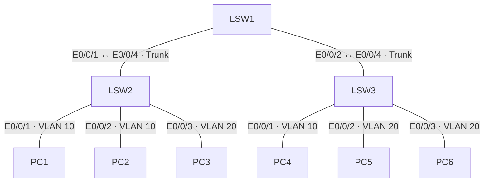
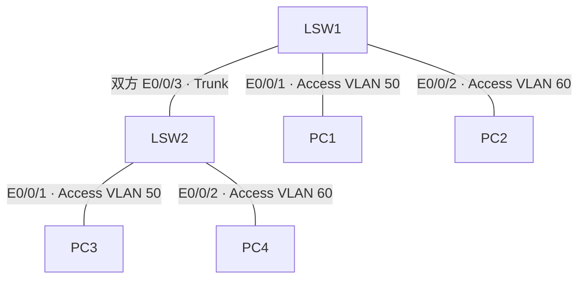

<!-- 计算机网络 / 局域网技术 VLAN Trunk 实践课 -->
# 第 16 课　实践：交换机 VLAN Trunk 配置与 802.1Q 验证

> 2026-11-19（周四）08:30 开始 · 实践课 · 局域网技术 / VLAN Trunk（教材具体节号未确认）

> **导读**  
> 一台交换机内部用 VLAN 分隔广播域；多台交换机之间用 Trunk 传递多个 VLAN 的帧。本课先完成“三交换机、六主机”的 VLAN 10/20 组网，再根据实验文档搭建“两交换机、四主机”的 VLAN 50/60 拓扑，重点理解端口的 PVID、802.1Q 标签与 Trunk 允许列表。**以下严格区分课堂任务、已见配置输出与尚未看到的验证结果。**

## 一、实验目的与 VLAN 基础

老师明确给出的实验目的：

1. 理解 VLAN 接口类型 **Trunk** 的含义。
2. 掌握以太网交换机的 **VLAN Trunk 配置**。

课堂首先讨论为什么划分广播域：

- 广播帧会消耗链路和主机处理资源；一个大二层广播域容易放大广播开销。
- 二层环路可能引发广播风暴；划分 VLAN 能限制传播范围，但不能代替 STP 等环路保护。
- 不同部门有隔离需求；VLAN 提供二层隔离，若配置三层互通则仍需 ACL/防火墙等访问控制。
- **VLAN 与物理位置无关**：同一 VLAN 的主机可以连接不同交换机，只要二层链路允许该 VLAN 通过。

### 1. IEEE 802.1Q：4 字节插在哪里

在 Ethernet II 帧的**源 MAC 之后、原 EtherType 之前**插入 4 B：

```text
普通帧：  [目的 MAC 6B][源 MAC 6B][EtherType 2B][Payload][FCS]
标记帧：[目的 MAC 6B][源 MAC 6B][TPID 2B][TCI 2B][EtherType 2B][Payload][FCS]
```

| 字段 | 位数 | 含义 |
|---|---:|---|
| TPID | 16 | 常用 `0x8100`，标识 802.1Q 标签 |
| PCP | 3 | 优先级，0–7 |
| DEI | 1 | 丢弃资格指示 |
| VID | 12 | VLAN ID |

`2^12 = 4096` 种编码（0–4095）；通常可用 VID 为 **1–4094**，0 表示仅携带优先级信息、4095 保留。单标签标准 Ethernet 最大帧由 **1518 B 增至 1522 B**（不含前导码及 SFD）。**VLAN ID 的值不会改变这 4 B 长度。**

### 2. Access、Trunk 与标签的生命周期

| 项目 | Access 接入链路 | Trunk 干道链路 |
|---|---|---|
| 典型对端 | 不感知 VLAN 的普通 PC | 另一台交换机、支持 VLAN 的设备 |
| 承载 VLAN | 通常一个 | 可以多个 |
| 线上帧 | 通常无 802.1Q Tag | 非 PVID VLAN 通常有 Tag，PVID VLAN 可无 Tag |
| 本课角色 | PC 到交换机 | 交换机到交换机 |

举例：PC1 属于 VLAN 10，PC4 在另一台交换机且也属于 VLAN 10；两端 Trunk PVID 均为 1。

1. PC1 发出无标签帧；
2. SW1 的 Access 端口将其归入 VLAN 10；
3. SW1 从 Trunk 发出时携带 VID 10；
4. 另一交换机按 VID 10 转发；
5. 到 PC4 的 Access 出口发出无标签帧。

交换机内部必须保留帧的 VLAN 归属信息，但**不必理解为内部每个环节都实际插入了 802.1Q 字节**。一条 Trunk 能承载多个 VLAN，是因为每个帧独立标识其 VLAN，而非每 VLAN 单独拉线；带宽仍由所有 VLAN 共享。

> **易错点**  
> **PVID 与 Trunk 允许列表不是同一回事**。`display port vlan` 中 `PVID 1 | Trunk VLAN List 10 20` 是正常配置：未标记帧的默认归属为 VLAN 1，但 VLAN 1 不一定被允许在此接口转发。另，用户说的“BID”在这里应为 **VID**；BID 是生成树语境中常见的 Bridge ID。

## 二、实验一：三交换机、六主机（VLAN 10 / 20）

老师拓扑：LSW1 在上方汇聚，LSW2/LSW3 在下方，各接三台 PC；VLAN 10 为 PC1、PC2、PC4，VLAN 20 为 PC3、PC5、PC6。



### 1. 关键命令

本次课堂讨论与实际配置使用华为 eNSP / VRP 命令：

| 命令 | 含义 |
|---|---|
| `system-view` | 进入系统视图 |
| `sysname LSW1` | 修改交换机名 |
| `vlan batch 10 20` | 批量创建 VLAN |
| `port link-type access` | 指定 Access 接口 |
| `port default vlan 10` | 将 Access 接口加入 VLAN 10 |
| `port link-type trunk` | 指定 Trunk 接口 |
| `port trunk allow-pass vlan 10 20` | 在当前允许列表中放行 10、20 |
| `undo port trunk allow-pass vlan 1` | 从允许列表中移除 VLAN 1 |
| `undo port trunk allow-pass vlan all` | 老师示例用于清理 Trunk 允许配置 |
| `display vlan` / `display port vlan` | 核对 VLAN 成员和端口属性 |

课堂还讨论了 **Port Group** 批量配置相同 VLAN 的连续 Access 接口，以代替逐端口输入。不同 eNSP/VRP 版本对临时端口组和命名端口组写法可能有差异，须以设备实际接受的命令为准。

### 2. 本次已看到的配置验证

**LSW1：** `display port vlan` 截图确认 E0/0/1、E0/0/2 为 Trunk，PVID 1，允许 VLAN 1、10、20；`display vlan` 确认 VLAN 10、20 已创建、两个接口为 tagged 成员。

随后 LSW2 / LSW3 也完成配置，三窗口截图同时展示各交换机的 `display vlan`、`display port vlan`：

| 设备 | E0/0/1 | E0/0/2 | E0/0/3 | E0/0/4 |
|---|---|---|---|---|
| LSW1 | Trunk：10、20 | Trunk：10、20 | — | — |
| LSW2 | Access 10 | Access 10 | Access 20 | Trunk：10、20 |
| LSW3 | Access 10 | Access 20 | Access 20 | Trunk：10、20 |

截图所见这四条 Trunk 的允许列表均为 **`1 10 20`**。用户随后希望与老师的示例一致，讨论了通过在各 Trunk 接口执行 `undo port trunk allow-pass vlan 1` 来去掉 VLAN 1，但**没有看到修改后四接口的完整再次核验截图**，因此不能记为已全部完成。

老师的文档示例中，Trunk 配置写成：

```text
port link-type trunk
undo port trunk allow-pass vlan all
port trunk allow-pass vlan 10 20
```

文档输出示例为 `PVID 1 | Trunk VLAN List 10 20`。其与初始实际截图 `PVID 1 | Trunk VLAN List 1 10 20` 的差别在**允许列表中的 VLAN 1**，不是主机 VLAN 分组错误。

**本阶段结论：** 交换机端口类型及 VLAN 成员关系在截图中得以核对；**PC 实际 Ping 结果未提供**，不写为已连通。

## 三、实验二：两交换机、四主机（VLAN 50 / 60）

老师后来展示了一项**新任务**，不能与上一组 VLAN 10/20 拓扑合并。



**分组由实验文档明确给出：**

- VLAN 50：**PC1 与 PC3**
- VLAN 60：**PC2 与 PC4**

两个交换机都在 E0/0/3 上连接 Trunk，E0/0/1 和 E0/0/2 分别接 VLAN 50、60 主机。

### 1. 老师布置的两轮实验

**第一轮**：两端 Trunk **仅允许 VLAN 50**。

- PC1 → PC3：按拓扑预期应通；
- PC2 → PC4：按拓扑预期不通，因为 VLAN 60 未经 Trunk 放行；
- 在 Trunk 链路抓包，观察是否含 802.1Q Tag、VID 值以及出入站帧的差异。

**第二轮**：两端 Trunk **增加 VLAN 60**。

- PC1 ↔ PC3：预期仍通；
- PC2 ↔ PC4：预期由不通变为可通；
- 对比两轮抓包，解释 Trunk allow-pass 列表的作用。

> **证据边界**  
> 上述“通/不通”都是实验要求与理论预期。当前对话没有提供第一轮 Ping 截图、第二轮 Ping 截图或 Wireshark 对应 Tag 的抓包截图，因此**实际测试结果未确认**。

### 2. 第一轮建议/实验所需命令

两台交换机各自的 Access 端口设置一致，Trunk 都是 E0/0/3：

```text
system-view
vlan batch 50 60

interface Ethernet 0/0/1
 port link-type access
 port default vlan 50
 quit

interface Ethernet 0/0/2
 port link-type access
 port default vlan 60
 quit

interface Ethernet 0/0/3
 port link-type trunk
 undo port trunk allow-pass vlan all
 port trunk allow-pass vlan 50
 quit

display port vlan
display vlan
```

以上为按老师第一轮任务整理的**应执行配置**，并非声称曾拍到这种状态。

第二轮在两端 E0/0/3 中添加：

```text
interface Ethernet 0/0/3
 port trunk allow-pass vlan 60
 quit
```

### 3. 第二组实际截图核对

2026-11-19 09:43 前后的课堂截图中，两台交换机均已经显示：

| 交换机 | E0/0/1 | E0/0/2 | E0/0/3 |
|---|---|---|---|
| LSW1 | Access / PVID 50 | Access / PVID 60 | Trunk / PVID 1 / **50 60** |
| LSW2 | Access / PVID 50 | Access / PVID 60 | Trunk / PVID 1 / **50 60** |

`display vlan` 也能看到 VLAN 50 与 VLAN 60 均存在，各自的 Access 端口为 untagged 成员，Trunk E0/0/3 为 tagged 成员。两端配置**与第二轮目标相符**。

但截图**没有证明第一轮曾实际只放行 VLAN 50 并完成故障对照**。课中曾提醒可以通过两端 `undo port trunk allow-pass vlan 60` 临时恢复第一轮状态，之后再重新放行。用户没有提供这部分执行结果。

### 4. 抓包应该怎样观察

- 普通 PC → Access：通常看不到 802.1Q 标签；交换机按 PVID/端口配置确认 VLAN。
- 本实验 Trunk 的 PVID 为 1，VLAN 50、60 的帧经 Trunk 发送时通常携带 802.1Q 标签。
- Wireshark 在 Trunk 链路上应重点查看 TPID 0x8100 和 **VLAN ID 50 / 60**。
- 若同一 VLAN 主机先通过 ARP 获取 MAC，再发送 ICMP Echo，请区分 ARP 广播、ARP 单播应答与 ICMP。
- 某 VLAN 在 Trunk 上不被允许时，其跨交换机帧无法被正常传递；不能把“同属 VLAN”直接理解为“必然可达”。

## 四、课堂中发现的容易混淆处

1. **两个拓扑不同：** 第一组是 3 Switch + 6 PC + VLAN 10/20；第二组是 2 Switch + 4 PC + VLAN 50/60。第二组不是把第一组端口号直接复用。
2. **VLAN 分组 vs Trunk 放行：** 第二组始终是 PC1/PC3 属于 VLAN 50、PC2/PC4 属于 VLAN 60；只允许 VLAN 50 的第一轮不会改变 PC 的归属。
3. **PVID 1 不等于允许 VLAN 1：** 老师的示例正好区分了这两个字段。
4. **删除放行权限不会删除 VLAN：** `undo port trunk allow-pass vlan 60` 只改变端口允许列表，不删除 VLAN 60，也不改变 Access 端口归属。
5. **Trunk 不增加带宽：** 多 VLAN 复用一条链路，但共享链路速率。
6. **配置正确 ≠ 通信已实测：** `display vlan` 和 `display port vlan` 只能确认配置状态；还须核对 PC IP、接口状态、实际 Ping 和抓包。

## 五、实验完成状态与待补证据

| 项目 | 状态 |
|---|---|
| 老师的 VLAN / Trunk 原理讲解 | 已记录 |
| 第一组（三交换机）拓扑及端口映射 | 已确认 |
| 第一组三台交换机 VLAN 与 Trunk 输出 | **有实际截图** |
| 第一组去除 Trunk 默认 VLAN 1 后的全量复核 | 未确认 |
| 第一组 PC Ping 结果 | 未确认 |
| 第二组（两交换机）拓扑及分组 | 已确认 |
| 第二组两端允许 VLAN 50、60 的配置 | **有实际截图，符合第二轮配置** |
| 第二组第一轮仅允许 VLAN 50 的测试 | 未确认 |
| 第二组两轮 Ping 对照 | 未确认 |
| Trunk 链路 Wireshark 802.1Q 抓包 | 未确认 |
| 老师要求的正式实验报告提交格式、截止时间 | 未确认 |

## 六、本课小结

- **VLAN 分隔二层广播域**，802.1Q 标签让跨交换机的 Trunk 能识别流量所属 VID。
- **Access 负责端口入 VLAN，Trunk 负责跨设备延伸 VLAN**；非 PVID VLAN 通常以 Tag 传送。
- 华为 VRP 核心配置为 `port link-type access/trunk`、`port default vlan` 和 `port trunk allow-pass vlan`；通过 `display vlan`、`display port vlan` 检查。
- 课堂先完成 **VLAN 10/20 三交换机配置**，后切到 **VLAN 50/60 两交换机的新实验任务**。
- **已经看到交换机配置证据，未看到端到端 Ping 和两轮 802.1Q 抓包证据**；后者不能凭预期补写。
