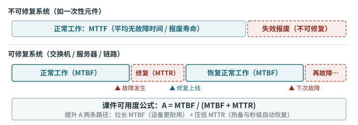
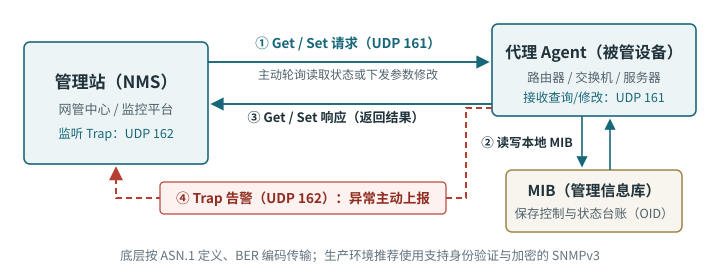
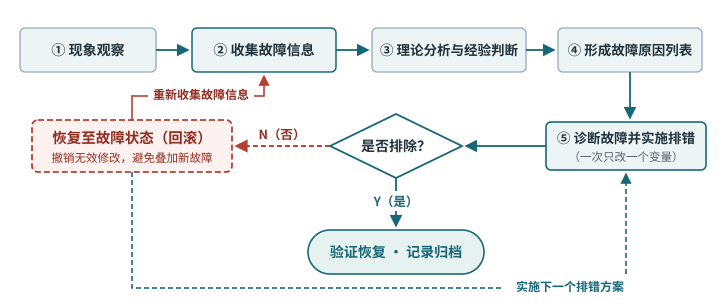
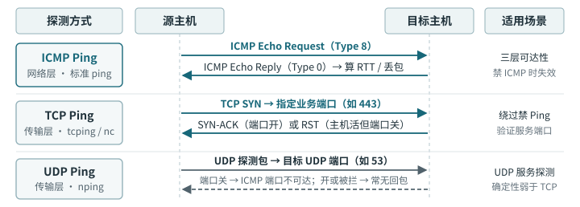
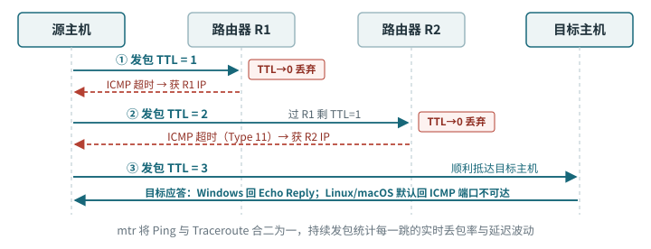
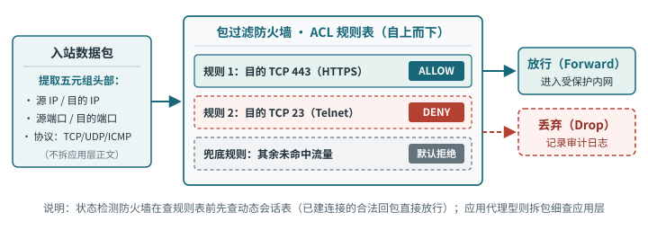

<!-- 计算机网络 / 第 6 章收尾 & 第 7 章 网络管理和网络安全 -->
# 第 17 课　网络服务收尾、网络管理与安全基础

> 2026-11-23（周一）14:00–15:20 · 理论课 · 第六章收尾 & 第七章《网络管理和网络安全》（7.1–7.3）

> **导读**  
> 本课先收束第六章的文件共享、邮件、远程访问、常用端口与 C/S·B/S 对比；随后切入第七章《网络管理和网络安全》，完整梳理网络管理架构、FCAPS 与性能可用度指标、SNMP/RMON 协议栈、网络故障排查流程与诊断工具，并开启网络安全隐患、DDoS、防火墙与加密基础（具体加密算法留待下课续讲）。

<!-- PAGE: 第六章收尾 · 文件共享与邮件 -->
## 一、第六章收尾：网络服务补完与总结

### 1. 文件共享回顾（FTP / SMB / NFS）

- **FTP**：基于 TCP，采用**控制通道（TCP 21）**与**数据通道（主动模式传统源端口 TCP 20，被动模式由服务端指定临时端口）**分离设计；常见软件包括 **vsftpd**（Linux 服务端）与 **FileZilla**（客户端与服务端）。原生传输为明文，工程上多用 FTPS 或 SFTP（TCP 22）。
- **SMB**（现代默认 **TCP 445**）：面向远程文件操作与共享锁，课堂回顾三类典型场景——**Hyper-V 虚拟化文件存储**、**Microsoft SQL Server over SMB**、**最终用户数据的传统存储**；新版特性强调**降低广域网访问延迟**（缓存/BranchCache/压缩）与**提升安全性、防范数据窃听**（SMB 3.x 原生加密与签名）。
- **NFS（网络文件系统）**：UNIX 体系中的 **C/S** 跨平台文件共享方案。课堂/传统模型要点：**底层跑在 UDP/IP，依靠 RPC（远程过程调用）执行远端操作，搭配 XDR（外部数据表示）统一跨平台数据格式**。
  - *工程口径注*：早期 NFSv2 默认使用 UDP/IP 配合 `rpcbind`（111），现代主流 **NFSv4** 已固定采用 **TCP 2049**；考试与概念题以课堂传统表述为准。

### 2. 邮件系统：SMTP、POP3 与 IMAP4

| 协议 | 方向与角色 | 默认端口（加密） | 核心机制与特点 |
|---|---|---|---|
| **SMTP** | **只推不拉（Push）**；MUA → 发件 MTA → 收件 MTA | TCP 25（提交 587 / 465） | 纯文本命令-应答，三阶段：**建立连接**（`EHLO/HELO`）→ **邮件传输**（`MAIL FROM`、`RCPT TO`、`DATA`）→ **释放连接**（`QUIT`） |
| **POP3** | **拉取（Pull）**；C/S，搬回本机 | TCP 110（POP3S 995） | 三阶段：**认证**（`USER`/`PASS`）→ **事务**（`STAT`/`LIST`/`RETR`/`DELE`/`RSET`）→ **更新**（`QUIT` 后才真删）；不支持多端状态同步 |
| **IMAP4** | **交互同步**；斯坦福大学开发 | TCP 143（IMAPS 993） | **无需下载全部邮件即可直接操作服务端邮箱**；支持按需拉头/正文与多设备已读、文件夹双向同步 |

- **Linux 常见 SMTP MTA**：**Sendmail**（元老、配置晦涩）、**Qmail**（安全模块化先驱、Maildir）、**Postfix**（现代自建主流，常配 Dovecot）、**Exim**（Debian/虚拟主机常用、规则灵活）。

> **课外延伸 · 内网伪造与一体化邮件栈**  
> 公网依赖 DNS 的 **SPF / DKIM / DMARC** 防域名冒充；但若**内网邮件服务器**对内部网段开放免认证中继，仍可直接伪造 `MAIL FROM` 与 `From:`。内网防伪造的核心是强制提交认证（SMTP AUTH + TLS）、登录身份与发件地址强绑定，并隔离打印机/告警白名单。另，现代 Rust 编写的 **Stalwart** 将 MTA（SMTP）与 IMAP/POP3/JMAP 及反垃圾集成为一体化全栈邮件服务器。

<!-- PAGE: 远程访问、端口表与 C/S·B/S -->
### 3. 远程登录与远程图形化协议

- **Telnet（TCP 23）**：TCP/IP 早期远程登录标准协议（NVT 虚拟终端），**全程明文传输**，用户名和密码存在严重窃听隐患；现多仅用于临时测试 TCP 端口连通性。
- **SSH（TCP 22）**：IETF 制定的应用层安全协议，Linux 标配（**OpenSSH** 由 OpenBSD 维护）。提供**传输加密**、**防 DNS 欺骗与 IP 欺骗**（靠服务端主机公钥指纹 `known_hosts` 校验）、**密码/公钥多种身份验证**以及**安全隧道**（SFTP、端口转发）。

| 远程图形协议 | 起源与生态 | 默认端口 | 机制与课堂要点 |
|---|---|---|---|
| **RDP** | 微软，基于 **ITU-T T.120** 拓展 | TCP/UDP 3389 | 规范支持最多 **64,000** 独立虚拟通道与多点传输；传绘图指令实现带宽缩减；传统教材表述为 RSA + RC4，现代 Windows 已升级为 **TLS + AES + NLA** |
| **VNC** | **AT&T**，跨平台（UNIX/Linux 常见） | TCP 5900+ | 基于 RFB 传输屏幕帧缓冲像素；早期内置 **Java Web**（5800 端口，现多由 HTML5 **noVNC** 替代） |
| **SPICE** | **Red Hat**，**KVM** 虚拟化专用 | 动态 5900+ | 含 SPICE 协议/服务端/客户端与虚拟机代理（QXL/`vdagent`），智能分流 2D 绘图与视频流，支持音频与 USB 透传 |

### 4. 常见网络服务与端口总表

| 服务类别 | 协议 | 传输层与经典端口 | 关键分工与现代补充 |
|---|---|---|---|
| **DHCP** | DHCPv4 | **UDP 67 / UDP 68** | 67 为服务端、68 为客户端；自动分发地址配置 |
| **DNS** | DNS | **UDP 53 / TCP 53** | 常规查询走 **UDP 53**；响应超长截断（TC=1）回退与主从区传输（AXFR/IXFR）走 **TCP 53** |
| **Web** | HTTP / HTTPS | **TCP 80 / TCP 443** | HTTP/3（QUIC）使用 UDP 443 |
| **FTP** | FTP | **TCP 21 / TCP 20** | 21 控制通道、20 主动模式数据源端口；SFTP 走 TCP 22 |
| **文件共享** | SMB / NFS | **TCP 445** / **UDP·TCP 2049** | 传统 NFSv2/v3 配合 `rpcbind` 111，现代 NFSv4 固定 TCP 2049 |
| **邮件** | SMTP / POP3 / IMAP | **TCP 25 / 110 / 143** | 加密常用：提交 587/465、POP3S 995、IMAPS 993 |
| **远程访问** | Telnet / SSH / RDP | **TCP 23 / 22 / 3389** | VNC 常用 TCP 5900+ |

### 5. C/S 与 B/S 对比及第六章随堂题

| 比较项 | C/S（客户机/服务器） | B/S（浏览器/服务器） |
|---|---|---|
| **客户端** | 需安装专用客户端软件 | 通用浏览器即可访问，无需专装 |
| **维护升级** | 客户端与服务端需同步升级，成本较高 | 逻辑集中在服务端，升级维护便捷 |
| **性能体验** | 强，可直接调用本机硬件与离线能力 | 受浏览器与网络往返制约 |
| **跨平台性** | 较弱，多系统需分别开发适配 | 极强，天然跨操作系统 |
| **典型例子** | 桌面即时通讯、网游、FileZilla、SSH 客户端 | 教务系统、网页邮箱、电商/OA 系统 |

> **随堂题回顾**  
> 问：网络操作系统的主要功能**不包括**哪项？（处理器管理 / 存储管理 / **路由转发** / 文件管理）  
> 答：**路由转发**。操作系统五大基本功能为处理器、存储、设备、文件、接口管理；路由转发属网络层路由器职责。第六章脉络至此闭环：`NOS 底座 → DHCP 拿址 → DNS 解析 → Web/文件/邮件/远程服务`。

<!-- PAGE: 第七章 · 安全演进与网络管理概论 -->
## 二、第七章：网络安全演进与网络管理概论（7.1）

### 1. 网络安全演进三阶段

| 阶段 | 核心特征 | 关键技术与思路 |
|---|---|---|
| **传统时代** | 人工运维与被动防御 | 单一边界防护（传统防火墙/特征库），默认内网可信，事后人工救火 |
| **现代时代** | 自动化与纵深防御体系 | 引入 **SNMP** 集中网管，融合 **IDS**（旁路检测报警）/ **IPS**（串联实时阻断），多层设卡与自动联动 |
| **智能时代** | AI 驱动与零信任架构 | **AIOps**（告警降噪、根因定位、异常预测）+ **零信任**（永不信任、始终验证，取消内网免检） |

### 2. 网络管理目标、指标与组织模式

**最终目标**：使网络性能达到最优状态。六大技术指标：**有效性**（管得准、见效快）、**可靠性**（网管自身稳健不先崩）、**开放性**（遵循公开标准、跨厂商兼容）、**综合性**（全栈统筹无孤岛）、**安全性**（防网管越权与窃听篡改）、**经济性**（投入与管理流量开销可控）。

| 管理模式 | 架构特点 | 优势 | 局限与适用范围 |
|---|---|---|---|
| **集中式** | 单中心网管站直管全网，最普遍 | 结构简单、成本低 | 扩展性差、单点可靠性低、易成传输瓶颈；适合**小型网络** |
| **分布式** | 多节点就近采集、**靠近问题源做基本决策** | 减轻中心负担、自适应与容错强 | 建设成本高、管理门槛高；适合广域分散自治大网 |
| **混合式** | **分布式基础上叠加集中总控**（分级/代理汇总） | 兼顾本地低延迟省带宽与总部全局视图 | 架构较复杂；大中型企业及多分支园区主流方案 |

### 3. 五大功能域（FCAPS）与课件二分架构

ISO 定义网络管理五大功能域 **FCAPS**：**故障管理（Fault）**、**配置管理（Configuration）**、**计费管理（Accounting）**、**性能管理（Performance）**、**安全管理（Security）**。课件按“观测 vs 干预”将其归为两大支：

- **网络监视功能（只读采集）**：**性能监视**、**故障监视**（故障预测、故障检测和报警、故障诊断和定位）、**计费监视**（采集流量/时长用于计费或分摊）。
- **网络控制功能（主动管控）**：
  1. **配置管理（7 模块）**：定义配置信息（建档）、设置和修改设备属性、定义和修改网络元素互联关系、启动和终止网络运行、发行软件、检查参数值和互联关系、报告配置现状。
  2. **安全管理（3 大块）**：防数据被掐断（可用性）、被偷看（机密性）、被改掉（完整性），威胁来源涵盖硬件、软件与通信线路：
     - **① 安全信息的维护**：记事件、盯审计（如撞库/爆破）、报警报做拦截、查记录做评估、护文件、看行为辨异常（用户行为基线）。
     - **② 资源访问控制**：保护网管关键命门——**安全编码、源路由和路由记录信息、路由表、目录表、报警门限、计费信息**。
     - **③ 加密过程控制**：必要时加密管理站与代理间报文，并具备**修改加密算法、重新分配密钥**的能力。

<!-- PAGE: 性能监视、可用度与 SLA -->
### 4. 性能监视五大指标与可用度（核心重点）

课件将性能监视拆成五项核心指标，其中 **① 可用性** 为重点概念与计算考点：

- **MTTF（平均无故障时间）**：设备从开始用到失效平均撑多久，用于度量**不可修复系统**的寿命（报废时间）。
- **MTBF（平均故障间隔时间）**：按课件口径，指**可修复系统**两次相邻故障之间的平均正常工作时间，衡量耐不耐坏（如企业级硬盘标称 250 万小时为大样本统计均值，非单盘寿命）。
- **MTTR（平均修复时间）**：从故障发生到修复上线平均耗时，越小恢复越快。

*图 17-1　不可修复系统与可修复系统时间轴对照及可用度公式。*

**算例**：若某设备 `MTBF = 990 h`、`MTTR = 10 h`，则可用度 `A = 990 / (990 + 10) = 99%`。

> **口径提示**  
> 部分可靠性工程教材将两次故障起点间隔定义为 `MTBF = MTTF + MTTR`（对应 `A = MTTF / MTBF`）；**本课与考试严格按课件口径 `A = MTBF / (MTBF + MTTR)` 计算**（分子为正常工作时长，分母为工作加维修总时长）。

| 性能指标 | 含义 | 归类（课件二分） |
|---|---|---|
| **① 可用性** | 正常可用时间占总时间的百分比（可用度 A） | **面向服务**（看用户体验） |
| **② 响应时间** | 从发出请求到看到结果的等待耗时，可分段查瓶颈 | **面向服务**（看用户体验） |
| **③ 正确性** | 传输是否出错、丢包、准确无误 | **面向服务**（看用户体验） |
| **④ 吞吐率** | 单位时间处理的数据量、会话或呼叫数（干了多少活） | **面向效率**（看资源利用） |
| **⑤ 利用率** | 链路或设备资源被占用的百分比（过高会致排队延迟飙升） | **面向效率**（看资源利用） |

> **联系实际 · 从可用度 A 到 SLA（服务等级协议）**  
> 工程中将实测可用度称作 **SLI**，内部红线称 **SLO**，写入对外商业合同并绑定违约赔付的承诺即是 **SLA**。常见“几个 9”对应的全年最多不可用时长：`99%` ≈ 3.65 天、`99.9%` ≈ 8.76 小时、`99.99%` ≈ 52.6 分钟、`99.999%` ≈ 5.26 分钟。高 SLA 离不开主备冗余与自动化压低 **MTTR**。

<!-- PAGE: 网管协议栈：ASN.1 到 SNMP 与 RMON -->
### 5. 常见网络管理协议（ASN.1 → BER → SMI → MIB → SNMP → RMON）

| 协议 / 规范 | 定位（课件类比） | 核心作用 |
|---|---|---|
| **1. ASN.1** | 抽象语法表示（统一快递面单） | 非编程语言，跨厂商统一数据结构描述规范（OSI 表示层，也用于 X.509 证书） |
| **2. BER** | 基本编码规则（装信封贴条码） | 将 ASN.1 定义的数据按 TLV 编码为网线上传输的 0/1 字节流并还原 |
| **3. SMI** | 管理信息结构（建表规则） | 规定 MIB 的树形唯一命名（OID）与允许的数据类型（Counter、Gauge 等） |
| **4. MIB** | 管理信息库（数据台账） | 保存被管设备**控制与状态信息**的逻辑字典，每项标注只读或读写权限 |
| **5. SNMP** | 简单网络管理协议（通信协议） | 应用层协议（基于 **UDP 161 / 162**），用于管理站读写 MIB 及代理上报异常 |

*图 17-2　SNMP 管理者—代理—MIB 四步模型（按课堂动图整理）。彻底断电硬宕机无法发 Trap，需靠轮询超时发现。*

- **SNMP 版本演进**：**SNMPv1**（最早最简单，仅靠明文团体名认人，安全最弱）→ **SNMPv2c**（新增批量读取 **`GetBulk`** 与 64 位计数，仍用明文团体名）→ **SNMPv3**（补齐**身份验证、加密传输、访问控制**，生产推荐）。
- **6. RMON（远程网络监视）**：对 SNMP + MIB-2（仅看单机自身）的补充，目标是**「一次看一整段网」**，靠子网探头提供五大功能：**（1）离线操作**（断连仍独立采集）、**（2）主动监视**（持续盯子网）、**（3）问题检测与报告**（破门限主动上报）、**（4）提供增值数据**（趋势统计、TopN 主机）、**（5）多管理站操作**（多总台同时读取）。

> **7.1 随堂习题与标准答案**  
> 1. SNMP 工作在 OSI 哪一层？**C. 应用层**（基于 UDP 属应用层）。  
> 2. SNMP 管理模型中，保存被管设备控制与状态信息的是？**C. MIB**。  
> 3. 代理向管理站主动报告异常事件使用的报文是？**C. Trap**。  
> 4. FCAPS 五大功能域：故障管理、配置管理、**计费管理**、性能管理、安全管理。  
> 5. 判断：SNMPv3 相比 v1/v2c 最大改进是引入了身份验证与加密机制。（**√ 正确**）

<!-- PAGE: 7.2 网络故障管理与排错流程 -->
## 三、网络故障管理与排查方法（7.2）

### 1. 故障概述与标准诊断流程

网络故障即网络“生病”（硬件损坏、软件漏洞、配置写错或病毒入侵导致不通或变慢），按表现分为两类：

| 故障类型 | 核心症状 | 常见诱因 |
|---|---|---|
| **连通性故障** | 彻底不通、Ping 失败、服务无法连接 | 网线/端口物理断开、VLAN/Trunk 未放行、IP/掩码/网关/路由错误、ACL 拦截、DNS 失效 |
| **性能故障** | 能连通但延迟高、抖动大、丢包、速率慢 | 链路拥塞、二层环路广播风暴、双工不匹配、设备 CPU 满载、路由绕路或无线干扰 |

*图 17-3　标准网络故障诊断流程图。排错失败必须先“恢复至故障状态”回滚无效改动，避免多处误改叠加新故障。*

### 2. 故障处理五步法与四种常用排查法

**一般处理五步法（“看病五步”）**：① **故障发现**（告警/报修/巡检）→ ② **信息收集**（现象、影响范围、时间及**最近的变更**）→ ③ **诊断定位**（分层/分块/分段配合命令缩小范围）→ ④ **故障修复**（换件/改配置并验证恢复）→ ⑤ **记录归档**（形成报告复盘防再发）。

| 排查方法 | 切分维度 | 典型用法 |
|---|---|---|
| **分层故障排除法** | 按 OSI 协议栈（物理 → 应用） | 先确认底层链路与物理状态正常，再逐层向上排查 |
| **分块故障排除法** | 按设备功能模块（接口、配置、路由、策略等） | 定位到目标设备后，按配置功能区块逐项核对 |
| **分段故障排除法** | 按端到端路径（本机 → 网关 → 外网 → 目标） | 将整条链路切段，配合 `ping`/`tracert` 定位中断跳点 |
| **替换法** | 用已知正常的备件替换疑点部件 | 换网线、光模块、端口或主机直验证，注意一次只换一项 |

<!-- PAGE: 故障诊断工具：ipconfig、ping 与 tracert -->
### 3. 常用网络故障诊断工具（含跨平台与工程补充）

#### （1）网络接口配置查看：`ipconfig` 跨平台对照

| 平台 | 常用命令 | 主要用途 |
|---|---|---|
| **Windows** | `ipconfig` / `ipconfig /all` / `/release` / `/renew` / `/flushdns` | 查 IP、掩码、默认网关、MAC、DNS，续约 DHCP 或清缓存 |
| **Linux（`iproute2`）** | `ip a`、`ip r`、`resolvectl status`（旧：`ifconfig`） | 查网卡地址、路由表与系统 DNS 配置 |
| **macOS** | `ifconfig`、`ipconfig getifaddr en0`、`netstat -rn`、`scutil --dns` | 查接口 IP、路由表与多接口 DNS 解析策略 |

#### （2）连通性与时延探测：`ping` 及 TCP / UDP Ping 补充

标准 `ping` 工作在网络层，发送 **ICMP Echo Request（Type 8）** 并等待 **ICMP Echo Reply（Type 0）** 以测量连通性、RTT 与丢包率。当目标主机或云安全组禁 ICMP 时，工程中常改用传输层探测（`tcping`、`nc -vz`、`nping`）。

*图 17-4　标准 ICMP Ping 与工程补充 TCP Ping、UDP Ping 探测机制对比。*

#### （3）路由路径追踪：`tracert`、`traceroute` 与 `mtr`

`tracert`（Windows）/ `traceroute`（Linux·macOS）利用 IPv4 首部 **TTL** 字段从 `1` 开始逐轮递增，让探测包在沿途每一跳路由器因 `TTL` 归零触发 **ICMP Time Exceeded（Type 11）**，从而依次绘制整条路径。

*图 17-5　路由追踪 TTL 逐跳递减机制。排查 `mtr` 时注意：仅中间某跳显示丢包而终点 0% 丢包，多为该跳对 ICMP 限速，非业务真丢包。*

<!-- PAGE: 7.3 网络安全隐患、DDoS 与防火墙 -->
## 四、网络安全隐患与防护基础（7.3，待下课续讲）

### 1. 四类安全隐患与攻击分类

1. **信息系统自身安全的脆弱性**：早期 TCP/IP 与明文协议（Telnet、FTP、HTTP、SNMPv1/v2c、ARP）重互通轻认证的先天设计缺陷。
2. **操作系统和应用程序漏洞**：代码实现缺陷导致的 **CVE** 补丁风险与未公开的 **0-day** 漏洞，需结合及时打补丁与最小暴露面防御。
3. **信息系统面临的四大安全威胁**：**信息泄露**（机密性）、**完整性破坏**（完整性）、**拒绝服务**（可用性）、**未授权访问**（访问控制）。
4. **常见攻击方法**：**主动攻击**包括冒充与伪装、破坏系统可用性（DoS/DDoS）、**攻击重放**（截获合法包重发，靠 Nonce/时间戳/序列号防御）；**被动攻击**包括网络嗅探与**电磁信号侦测**（侧信道辐射窃听）。

### 2. 典型攻击案例：DoS / DDoS 与 2016 Mirai

- **原理**：DoS 靠海量请求耗尽带宽、协议栈连接队列（如 SYN Flood）或服务器算力；**DDoS** 控制庞大僵尸网络（Botnet）分布式齐射，单点封 IP 失效。
- **真实案例（2016 年 Mirai）**：扫描公网开放 **Telnet** 且使用**默认弱口令**的物联网设备（摄像头、路由器）组成数十万台僵尸网络，猛攻核心 DNS 服务商 **Dyn**，导致欧美多家主流网站大面积瘫痪。
- **防护思路**：**CDN 分散**（Anycast 边缘吸收并隐藏源站）→ **流量清洗**（BGP 引流至高防清洗中心过滤恶意包）→ **限流与黑洞路由**（超出总带宽极限时丢弃受害 IP 全部流量，断臂保护机房其余业务）。

### 3. 防火墙三大类型对比

| 防火墙类型 | 工作层级 | 核心机制与特点 |
|---|---|---|
| **包过滤型** | 网络层 / 传输层 | 逐包核对五元组与 ACL 规则；**速度快、开销低**，但无状态且不识应用层内容 |
| **状态检测型** | L3/L4 + 状态表 | 维护动态会话表，仅放行已建连接的合法回包；现代主流（如 Linux `nftables`、macOS/OpenBSD **`pf`**） |
| **应用代理型** | 应用层（L7） | 拆包审查应用层内容并代建新连接；审计最深但开销大（现代演进为 WAF / NGFW） |

<!-- PAGE: 包过滤图解、加密开篇与本课小结 -->
### 4. 防火墙数据包过滤过程

*图 17-6　包过滤防火墙按五元组自上而下匹配规则及默认拒绝策略示意。*

> **联系实际 · 本机安全工具对照**  
> macOS 底层 **`pf`** 为内核级状态检测防火墙；**LuLu** 为主机进程级出站防火墙（盯具体可执行程序外联）；**Loon** 虽主业为代理分流，但其按域名/URL 执行 `REJECT` 或 MITM 过滤在机制上贴近应用代理型（L7）思路。

### 5. 加密技术开篇（下课续讲）

**加密**通过加密算法与密钥将**明文**转换为**密文**，没有正确密钥即使截获也无法解读（现代密码学遵循**柯克霍夫原则**：算法本身公开，安全性依赖密钥的保密性）。对称加密、非对称加密与数字签名等具体机制留待第 18 课继续展开。

## 五、本课小结

1. **第六章收束**：文件共享记清 FTP 双通道、SMB（TCP 445）与 NFS（RPC+XDR，传统 UDP/现代 TCP 2049）；邮件记清 SMTP 只推不拉（25）、POP3 搬回本机（110）、IMAP4 服务端同步（143）；端口总表务必记住 **DNS 同时使用 UDP 53 与 TCP 53**。
2. **网络管理（7.1）**：掌握 **FCAPS** 五大功能域与课件“监视/控制”二分；重点吃透 **MTTF / MTBF / MTTR** 及课件可用度公式 `A = MTBF / (MTBF + MTTR)`；理清 **ASN.1 → BER → SMI → MIB → SNMP（v1/v2c/v3）→ RMON** 完整协议栈。
3. **故障排查（7.2）**：分清连通性与性能两类故障，记住标准排错流程图中的**失败先回滚（恢复至故障状态）**原则，熟练配合分层/分块/分段/替换法及 `ipconfig`、`ping`（含 TCP/UDP Ping）、`tracert`/`mtr` 定位问题。
4. **网络安全基础（7.3）**：以 2016 Mirai 为镜理解 DDoS 与三层防护，掌握包过滤、状态检测、应用代理三类防火墙差异，为下节课加密算法做好衔接。

**核对资料**　[SNMPv3 架构（RFC 3411）](https://www.rfc-editor.org/rfc/rfc3411) · [RMON（RFC 2819）](https://www.rfc-editor.org/rfc/rfc2819) · [ICMPv4（RFC 792）](https://www.rfc-editor.org/rfc/rfc792) · [IMAP4rev2（RFC 9051）](https://www.rfc-editor.org/rfc/rfc9051) · [POP3（RFC 1939）](https://www.rfc-editor.org/rfc/rfc1939)
