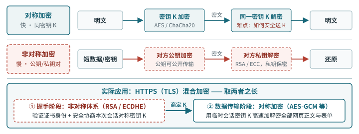
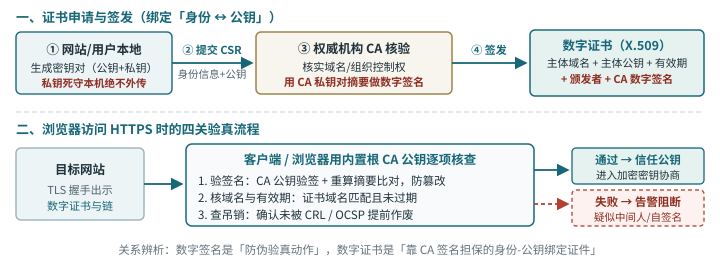
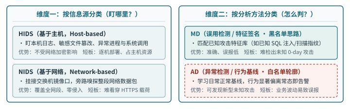
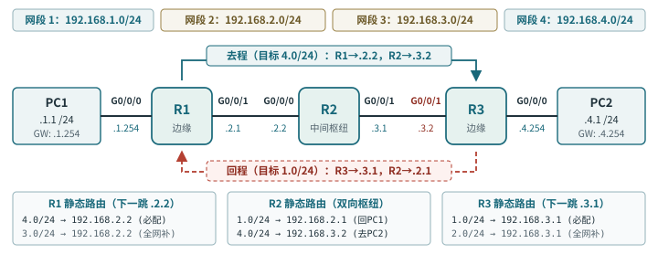
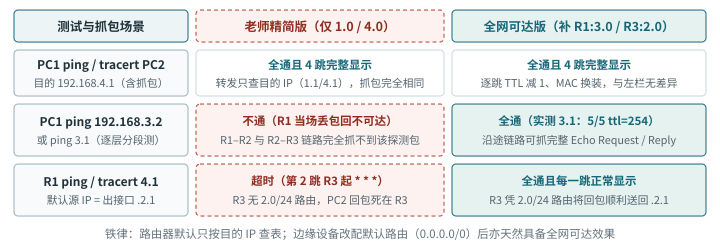
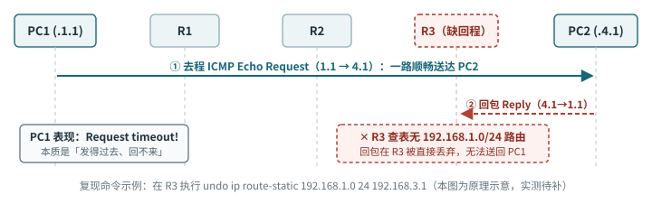

<!-- 计算机网络 / 第 7.3 节收尾 & 静态与默认路由实践 -->
# 第 18 课　网络安全防范技术与静态路由实践

> 2026-11-26（周四）08:30 开始 · 理论 + 实践课 · 第 7.3 节收尾 & eNSP 静态与默认路由实践

> **导读**  
> 本课前半段承接第 17 课，系统收尾第 7.3 节网络安全防范技术（对称/非对称/混合加密、数字签名与 CA 数字证书、入侵检测 IDS、防病毒与漏洞扫描）；后半段进入华为 eNSP 实践，围绕“三路由器、四网段”完成静态路由配置、现场排错与逐层 Ping 验证，并辨析“最小够用版 vs 全网可达版”在路由追踪与抓包中的差异。**实践部分严格区分课堂任务、已见实拍证据与尚未提供的实测结果。**

<!-- PAGE: 7.3 加密技术与 HTTPS 混合加密 -->
## 一、网络安全防范技术收尾（7.3）

### 1. 加密技术：对称、非对称与混合加密

密码学遵循**柯克霍夫原则**：加密算法本身可以公开，通信安全依赖于**密钥**的保密性。按加解密是否使用同一把密钥，分为对称加密与非对称加密两类：

| 比较维度 | 对称加密（Symmetric） | 非对称加密（Asymmetric / 公钥密码） |
|---|---|---|
| **密钥结构** | **同一把共享密钥**完成加密与解密 | **成对公钥 + 私钥**：公钥可公开分发，私钥必须绝对保密 |
| **核心用途** | 高速加密大量业务正文数据 | ① **对方公钥加密 → 对方私钥解密**（保密传输/协商密钥）<br>② **己方私钥签名 → 公开公钥验签**（身份认证、防篡改与不可抵赖） |
| **典型算法** | **AES**（现代主力）、ChaCha20、国密 SM4 *(旧：DES/3DES)* | **RSA**、**ECC / ECDHE / Ed25519**、国密 SM2 |
| **优势与短板** | **计算速度极快**；短板是**密钥分发困难**（公网难以安全传递共享密钥） | 彻底解决密钥分发难题；短板是数学运算**速度慢**，不适合直接加密大流 |



*图 18-1　对称加密、非对称加密与 HTTPS（TLS）混合加密工作流程对照。*

- **实际应用：混合加密与 HTTPS（TLS）**：对称加密快但密钥分发难，非对称加密安全但速度慢，现代 HTTPS 将两者结合——**握手阶段**用非对称体系验证服务器身份并安全协商一把本次会话专属的**临时对称会话密钥**；**正式传输阶段**切回 **AES-GCM / ChaCha20** 等对称算法高速加密全部网页正文。
  - *工程补注*：早期 HTTPS 常以 RSA 直接加密传预主密钥；现代 **TLS 1.3** 普遍采用 **ECDHE** 临时密钥交换实现**前向保密（PFS）**，即使日后服务器长期私钥泄露，历史抓包流量仍无法被逆向解密。

<!-- PAGE: 数字签名、数字证书与 CA 流程 -->
### 2. 数字签名、数字证书与 CA 流程

- **数字签名（Digital Signature）**：针对某份具体报文或文件，发件人先计算原文的**单向哈希摘要（如 SHA-256）**，再用**己方私钥**对摘要加密生成签名随原文发出；收件人用**发件人公钥**验签取出摘要，并与自己重算的原文摘要比对。一致即证明**来源真实、未被篡改且不可抵赖**。
- **数字证书（Digital Certificate，典型标准 X.509）**：仅靠公钥体系无法阻止中间人掉包假公钥；因此引入权威第三方**证书颁发机构（CA）**核实申请人身份后，用 **CA 私钥**对“主体身份信息 + 主体公钥 + 有效期”做数字签名，签发电子身份证。底层常以第 17 课所述 **ASN.1 / DER** 编码。

| 比较项 | 数字签名 | 数字证书 |
|---|---|---|
| **本质** | 一种**密码学防伪验证机制/结果**（电子亲笔签章） | 一份**绑定「实体身份 ↔ 公钥」的电子凭证**（电子身份证） |
| **解决的核心问题** | 证明具体数据**是谁发的、有没有被改过** | 证明**这把公钥确实属于某个合法实体**（防中间人冒充公钥） |
| **签发者** | 报文/文件的**发送方**使用自己的私钥签名 | 权威 **CA 机构**核验后使用 CA 私钥签发 |
| **两者联系** | **为数字证书提供防伪保障**（证书靠 CA 的数字签名防篡改） | **为日常验签提供公钥信任前提**（先验书确认为真公钥，再验对方签名） |



*图 18-2　CA 数字证书申请签发（CSR → CA 签发）与浏览器访问 HTTPS 时的四关验真流程。*

> **联系实际 · CA 信任“木桶效应”与现代治理补丁**  
> 课堂模型假定权威 CA 普遍可信，但现实 Web PKI 存在**“最弱木桶效应”**：系统预装数十上百家根 CA，只要任一家被攻破或违规乱签（如 2011 年荷兰 DigiNotar 遭黑、2014 年印度 NIC 违规签发 Google 域名证书等事件），理论上都可能签出全网任意域名的假证书。为此现代互联网叠加了 **CT（证书透明度公开日志）**、**DNS CAA 记录**（限定本域仅允许指定 CA 签发）与吊销审计来制约 CA 权力。

<!-- PAGE: 入侵检测、防病毒与漏洞扫描 -->
### 3. 入侵检测技术（IDS）

**入侵检测（ID）**指识别针对系统的非法入侵或异常行为，**IDS（入侵检测系统）**将其自动化运行。与传统防火墙“被动按规则守大门”不同，**IDS 主动巡查分析**（旁路镜像监听为主，发现入侵及时告警；若串联部署直接阻断流量则升级为 **IPS**）。



*图 18-3　IDS 按信息源（HIDS / NIDS）与按分析方法（MD / AD）的二维分类及优缺点对照。*

- *工程补充*：开源 HIDS 常见 **Wazuh / OSSEC / Falco**，NIDS 常见 **Snort / Suricata / Zeek**；实战多采用 **MD（特征库秒杀已知）+ AD（基线/AI 兜底未知 0-day）**混合检测。

### 4. 防病毒技术与计算机病毒分类

**计算机病毒**是人为编制、能自我复制传染并破坏系统功能或数据的恶意代码，六大经典特征：**传染性**（最核心本质）、**破坏性**、**隐蔽性**、**潜伏性**、**可触发性**、**寄生性/非授权性**。

| 分类维度 | 典型子类 | 含义速记 |
|---|---|---|
| **按存在媒介** | **网络病毒 / 文件病毒 / 引导型病毒** | 分别经网络传播、寄生可执行文件/文档宏、感染磁盘引导扇区（MBR） |
| **按破坏能力** | **良性病毒 / 恶性病毒** | 良性仅干扰显示或占资源；恶性删数据、加密勒索或损毁系统 |
| **按传染方法** | **驻留型 / 非驻留型** | 驻留型常驻内存伺机持续传染；非驻留型运行完成即退出内存 |
| **按链接方式** | **源码型 / 入侵型 / 外壳型 / 操作系统型** | 插入源码、替换原代码片段、包裹宿主首尾（最常见）、劫持/替代 OS 模块 |

- *易混辨析*：**病毒**依赖宿主文件传染；**蠕虫（Worm）**独立借网络漏洞主动全网扩散；**木马（Trojan）**伪装正常软件骗取安装并留后门，本身不强调自我复制。

### 5. 漏洞扫描与端口扫描原理

**漏洞扫描**在防御侧是“主动安全体检”，用于抢在攻击者前自查多余开放端口、过时组件 **CVE**、弱口令与配置缺陷：

- **端口扫描原理**（衔接第 17 课 TCP 探测）：**TCP 全连接扫描**（`nmap -sT`）完整走完三次握手，准确但留痕明显；**TCP 半开扫描 / SYN 扫描**（`nmap -sS`）仅发 `SYN`，收到 `SYN-ACK` 判定端口开放后立即回 `RST` 掐断（快且隐蔽），收 `RST` 为关闭，无响应多被防火墙过滤。
- **指纹与漏洞验证**：识别端口服务 Banner/版本（如 `nmap -sV`）并对照 CVE 漏洞库或发送验证探针。常见工具：**Nmap / Masscan**（端口资产）、**Nessus / OpenVAS / Nuclei**（综合与模板化漏洞扫描）。**合规底线**：仅可扫描自有或获明确授权的目标。

<!-- PAGE: 实践 · 静态与默认路由概念及拓扑 -->
## 二、实践：三路由器静态与默认路由配置

### 1. 小组任务与四大基础概念

**小组任务主线**：`地址规划 → 双向配置 → 逐层 ping → 默认路由 → 故障复现（每组删一条回程路由并解释现象）`。

1. **路由表 = 导航地图**：记录「目的网段 → 下一跳」，**下一跳必须是相邻可直连对端设备的接口 IP**（绝非本机出接口 IP）。
2. **静态路由 vs 默认路由**：静态路由由人工写死去往特定非直连网段的路径；默认路由（`0.0.0.0/0`）是特殊的静态路由，按**最长前缀匹配**在路由表无更精确条目时兜底转发。
3. **网关**：PC 只认识本网段，跨网段流量全部先交给默认网关，**网关必须等于直连路由器的接口 IP**。
4. **回程路由**：通信必须双向有路由；只配去程不配回程，就会出现「发得过去、回不来」的超时故障。
5. **路由进表前提**：接口先配好 IP 且状态为 `up up`，本设备直连网段才自动进表，指向该直连网段内邻居的静态路由也才会激活进表。

### 2. 拓扑结构、地址规划与路由命令拆解

本实验用三台路由器串起四个 `/24` 网段（`PC1 — R1 — R2 — R3 — PC2`），接线时务必注意 **R2 `GE0/0/1` 对接 R3 `GE0/0/1`**、R3 接 PC2 的是 **`GE0/0/0`**：

| 设备 | 接口 | IP 地址 / 掩码 | 网关 / 连接说明 |
|---|---|---|---|
| **PC1** | `Eth0/0/1` | `192.168.1.1/24` | 网关 `192.168.1.254`（连 R1 `GE0/0/0`） |
| **R1** | `GE0/0/0` / `GE0/0/1` | `192.168.1.254/24` / `192.168.2.1/24` | `GE0/0/0` 为 PC1 网关；`GE0/0/1` 连 R2 `GE0/0/0` |
| **R2** | `GE0/0/0` / `GE0/0/1` | `192.168.2.2/24` / `192.168.3.1/24` | 中间枢纽：左连 R1 `GE0/0/1`，右连 R3 `GE0/0/1` |
| **R3** | `GE0/0/1` / `GE0/0/0` | `192.168.3.2/24` / `192.168.4.254/24` | `GE0/0/1` 连 R2 `GE0/0/1`；`GE0/0/0` 为 PC2 网关 |
| **PC2** | `Eth0/0/1` | `192.168.4.1/24` | 网关 `192.168.4.254`（连 R3 `GE0/0/0`） |



*图 18-4　三路由器四网段全景拓扑、接口编址与各路由器静态路由下一跳拆解。*

> **易错辨析 · 为什么目的地址写 `192.168.4.0 24` 而不是 `192.168.4.1`？**  
> 路由器按**整个网段（网络地址）**指路：PC2（`4.1`）与 R3 网关（`4.254`）按 `/24` 与掩码相与后网络号均为 `192.168.4.0`。写一条 `192.168.4.0 24` 即可覆盖该网段全部 254 个主机地址；若掩码为 `/24` 却把主机位写成 `.1`，VRP 会报错不匹配（仅当掩码写成 `/32` 做“单主机路由”时才写具体主机 IP）。

<!-- PAGE: 华为 VRP 配置与现场排错复盘 -->
### 3. 华为 eNSP / VRP 完整配置命令

**前置动作提醒**：每台路由器配完接口 IP 后执行 `undo shutdown`，用 `display ip interface brief` 确认两个接口均为 `up up`；PC 填完 IP、掩码、网关后务必点击**『应用』**。

```text
# R1（边缘路由器，额外补 3.0/24 实现全网段可达）
system-view
sysname R1
interface GigabitEthernet 0/0/0
 ip address 192.168.1.254 24
 undo shutdown
 quit
interface GigabitEthernet 0/0/1
 ip address 192.168.2.1 24
 undo shutdown
 quit
ip route-static 192.168.3.0 24 192.168.2.2
ip route-static 192.168.4.0 24 192.168.2.2
```

```text
# R2（中间枢纽，必须配齐左右双向路由）
system-view
sysname R2
interface GigabitEthernet 0/0/0
 ip address 192.168.2.2 24
 undo shutdown
 quit
interface GigabitEthernet 0/0/1
 ip address 192.168.3.1 24
 undo shutdown
 quit
ip route-static 192.168.1.0 24 192.168.2.1
ip route-static 192.168.4.0 24 192.168.3.2
```

```text
# R3（边缘路由器，额外补 2.0/24 实现全网段可达；注意掩码 24 与 255.255.255.0 等价）
system-view
sysname R3
interface GigabitEthernet 0/0/1
 ip address 192.168.3.2 24
 undo shutdown
 quit
interface GigabitEthernet 0/0/0
 ip address 192.168.4.254 24
 undo shutdown
 quit
ip route-static 192.168.1.0 24 192.168.3.1
ip route-static 192.168.2.0 24 192.168.3.1
```

- **纠错与核对命令**：误配静态路由时在原命令前加 **`undo`** 删除（如 `undo ip route-static 192.168.3.0 24 192.168.2.2`）；用 `display current-configuration | include ip route-static` 查写入的配置，用 `display ip routing-table` 查已激活进表的路由。

### 4. 课堂实操现场排错复盘（R2 路由不进表）

实操中 `[R2]` 曾出现误敲 R1 路由与接口地址错配的情况，经两轮 `display ip routing-table` 实拍截图精准排清：

1. **第一轮排查**：截图中 `[R2]` 路由表仅有 6 条直连、**0 条静态路由**，直连接口竟显示 `GE0/0/0 = 192.168.1.254`、`GE0/0/1 = 192.168.2.1`（错配成 R1 地址），导致指向 `192.168.3.2` 的静态路由因下一跳不可达无法进表。
2. **第二轮排查**：修正 `GE0/0/1 = 192.168.3.1/24` 后，右边 `192.168.4.0/24 → 192.168.3.2` 立即激活进表（总计 7 条）；但 `GE0/0/0` 仍残留 `192.168.1.254/24`，遂将其覆盖改为 `192.168.2.2/24`。
3. **最终验证**：`192.168.2.0/24` 直连进表后，回程 `192.168.1.0/24 → 192.168.2.1` 自动生效，三台路由器路由表全部对齐。**排错启示**：静态路由不进表，先查 `display ip routing-table` 里的直连网段与接口 IP 是否对应正确。

<!-- PAGE: 路由表实测与逐层 Ping 证据 -->
### 5. 已核验的配置与连通性实证

#### （1）三台路由器同框 `display ip routing-table` 实拍核对

课堂 09:30 实拍的三窗口同框截图确认，R1、R2、R3 均为 `Destinations : 8, Routes : 8`；直连路由默认优先级 `Pre = 0`，华为 VRP 静态路由默认优先级 **`Pre = 60`**、标志 **`RD`**（Relay + Download to FIB，已下发转发表）：

| 路由器 | 已见直连网段（`Direct`，Pre 0） | 已见生效静态路由（`Static`，Pre 60，Flags `RD`） | 核对结论 |
|---|---|---|---|
| **R1** | `192.168.1.0/24` (`GE0/0/0`)<br>`192.168.2.0/24` (`GE0/0/1`) | `192.168.3.0/24 → 192.168.2.2` (`GE0/0/1`)<br>`192.168.4.0/24 → 192.168.2.2` (`GE0/0/1`) | **已实拍核实** |
| **R2** | `192.168.2.0/24` (`GE0/0/0`)<br>`192.168.3.0/24` (`GE0/0/1`) | `192.168.1.0/24 → 192.168.2.1` (`GE0/0/0`)<br>`192.168.4.0/24 → 192.168.3.2` (`GE0/0/1`) | **已实拍核实** |
| **R3** | `192.168.3.0/24` (`GE0/0/1`)<br>`192.168.4.0/24` (`GE0/0/0`) | `192.168.1.0/24 → 192.168.3.1` (`GE0/0/1`)<br>`192.168.2.0/24 → 192.168.3.1` (`GE0/0/1`) | **已实拍核实** |

#### （2）PC1 逐层 Ping 实拍实测记录

课堂 09:51 实拍的 PC1 命令行窗口输出验证如下（全部 5 发 5 收、`0.00%` 丢包）：

| 测试命令（PC1 发起） | 目标角色 | 实测结果与延迟 | 观察到的 `TTL` 及原理解读 |
|---|---|---|---|
| `ping 192.168.2.2` | R2 左口（`GE0/0/0`） | 5/5 通，min/avg/max `31/43/62 ms` | **`ttl=254`**（华为路由器初始 TTL=255，回程经 R1 减 1） |
| `ping 192.168.3.1` | R2 右口（`GE0/0/1`） | 5/5 通，min/avg/max `31/40/47 ms` | **`ttl=254`**（同为 R2 应答；**直接实证 R1 补配的 `3.0/24` 生效**） |
| `ping 192.168.4.254` | R3 下行口（PC2 网关） | 5/5 通，min/avg/max `47/56/62 ms` | **`ttl=253`**（R3 初始 255，回程经 R2、R1 两跳减 2，精准递减） |

#### （3）eNSP 工程包 `net.zip` 核查纪要

对课后打包的 `net.zip` 解包只读核查确认：
- `net/net.topo` 完整保存了 3 台路由器（`Router` 型号：R1、R2、R3）与 2 台 PC 的拓扑连线及终端配置：**PC1 = `192.168.1.1 / 255.255.255.0`（网关 `192.168.1.254`）**，**PC2 = `192.168.4.1 / 255.255.255.0`（网关 `192.168.4.254`）**。
- 三台路由器子目录下保存的是 eNSP 私有闪存文件 `flash.efz`（各 `2,468 B`，无独立明文 `.cfg`）。**操作提醒**：在 eNSP 中保存拓扑文件前，务必先在每台路由器用户视图（`<R1>`）敲 **`save`** 写入闪存，避免下次重开工程时配置丢失。

<!-- PAGE: 深入辨析：两版本对照、抓包与路由劫持 -->
### 6. 深入辨析：老师精简版 vs 全网可达版

课堂对照 PPT 第 12 页发现：老师在 R3 仅配置了 `192.168.1.0/24`（同理 R1 仅需配 `192.168.4.0/24`），而咱们在 R1 额外补了 **`192.168.3.0/24`**、在 R3 额外补了 **`192.168.2.0/24`**。

- **为什么两条额外路由大有用处？**
  1. **支持逐层分段排错**（衔接第 17 课分段排除法）：从 PC1 可依次点亮 `1.254 → 2.2 → 3.1 → 3.2 → 4.254 → 4.1` 沿途每个接口，不会因 R1 不认识 `3.0/24` 误判 R2–R3 链路断开；
  2. **支持路由器自身跨跳互测**：在 R1 上直接 `ping 192.168.3.2` 或 `ping 192.168.4.1` 时，源 IP 默认取自出接口 `192.168.2.1`，依赖 R3 上的 `2.0/24` 才能顺利回包；
  3. **贴合生产运维需求**：便于网管终端跨跳 SSH 或 SNMP 管理远端路由器互联接口。



*图 18-5　两种配置版本在不同探测源、路由追踪与中途 Wireshark 抓包中的差异对照。*

- **最反直觉的机制洞察**：在老师精简版中，PC1 执行 `tracert 192.168.4.1` 时**依然能完整看到第 3 跳 R3（`192.168.3.2`）的回包**，但转身直接 `ping 192.168.3.2` 却不通！根源在于**普通路由器转发只查目的 IP、不查源 IP**（未启用严格 uRPF 时）：`tracert 4.1` 的超时回包目的 IP 是 `1.1`，沿途皆有路由；而 `ping 3.2` 的目的 IP 是 `3.2`，R1 查表无 `3.0/24` 直接丢弃。

> **课外延伸 · “偷路由”与 BGP 路由劫持 / RPKI**  
> 路由器只按路由表“最长前缀匹配”转发的特性，一旦在公网遇到缺乏认证的传统 **BGP** 广播，就会引发**路由劫持（Route Hijacking）**：攻击者或误配置运营商向公网广播比合法 `/22` 更精细的 **`/24`** 假路由，就能把全球发往目标的流量全部拐走（如 2008 年巴基斯坦电信误宣 YouTube `/24` 致全球流量黑洞）。现代互联网正是用本课前半段所学的**公钥与数字证书（PKI）**构建了 **RPKI + ROA**，靠密码学签名验证某 IP 前缀是否允许由特定 AS 号广播，从源头封堵假路由。

<!-- PAGE: 故障复现机理、证据边界与本课小结 -->
### 7. 默认路由替换与回程故障复现（原理与预期）

- **边缘默认路由替身**：R1、R3 均只有一个对外出口（末梢路由器），可用一条默认路由替代多条明细静态路由（且天然兼顾 `2.0/24`、`3.0/24` 全网可达）——R1 配 `ip route-static 0.0.0.0 0 192.168.2.2`，R3 配 `ip route-static 0.0.0.0 0 192.168.3.1`。**切忌两台相邻路由器互相指默认路由**，否则查不到目标时会形成路由环路直至 TTL 归零。
- **删回程路由故障复现机理**：若在 R3（或 R2）执行 `undo ip route-static 192.168.1.0 24 192.168.3.1` 删掉回程路由，PC1 去 `ping 192.168.4.1` 将表现为 **`Request timeout!`**。



*图 18-6　回程路由缺失导致的“发得过去、回不来”超时故障机理示意（待实测抓包/Ping 补证）。*

### 8. 实验完成状态与待补证据

| 实验项目 | 当前状态（严格按已见证据记录） |
|---|---|
| 三路由器拓扑构建与 PC1/PC2 地址及网关配置 | **已确认**（`net.zip` 内 `net.topo` 核实无误） |
| R1 / R2 / R3 接口与全网可达版双向静态路由表 | **已实拍核实**（三窗口同框各 8 条路由，含 R2 排错修复） |
| PC1 逐层 Ping（`2.2`、`3.1`、`4.254`）与 TTL 递减 | **已实拍核实**（全部 5/5 通、`0.00%` 丢包、`ttl 254→253`） |
| PC1 → PC2 端到端 `ping 192.168.4.1` 与 `tracert` 截图 | **未提供截图**（理论与配置均已具备，待实测留证） |
| 边缘路由器改配默认路由（`0.0.0.0/0`）后复测 | **未提供截图**（理论预期与命令已列明） |
| 删一条回程路由故障复现截图与中途 Wireshark 抓包 | **未提供截图**（故障机理已图解，实验报告需实测补图） |

## 三、本课小结

1. **7.3 安全技术收尾**：**混合加密（HTTPS）**以非对称谈密钥+验身份、以对称高速传正文；**数字签名**防篡改防抵赖，**CA 数字证书**绑身份与公钥；**IDS** 记清 HIDS/NIDS 与 MD/AD；病毒记清六大特点与四类分法；端口扫描分清全连接 `-sT` 与半开 `-sS`。
2. **静态与默认路由实践**：掌握“路由表只看目的 IP、下一跳写相邻对端、接口 `up` 路由才进表、通信须双向有回程”四条铁律；已实拍完成 R1/R2/R3 路由表与 PC1 逐层 Ping 验证，并吃透精简版与全网可达版在 `tracert`/抓包及公网 BGP/RPKI 中的深层联系。

**核对资料**　[TLS 1.3（RFC 8446）](https://www.rfc-editor.org/rfc/rfc8446) · [X.509 PKI（RFC 5280）](https://www.rfc-editor.org/rfc/rfc5280) · [证书透明度 CT（RFC 9162）](https://www.rfc-editor.org/rfc/rfc9162) · [RPKI 架构（RFC 6480）](https://www.rfc-editor.org/rfc/rfc6480)
