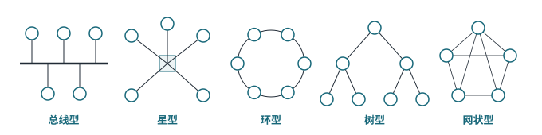

<!-- 计算机网络 / 第 1 章 计算机网络的基本概念 -->
# 第 2 课　网络发展、拓扑结构与传输介质

> 2026-09-17（周四）· 理论课 · 教材 1.1、1.3、1.4

## 一、网络发展里的几个名字

| 名称 | 要点 |
|---|---|
| ARPANET | 互联网的前身，采用**分组交换** |
| NSFNET | 美国国家科学基金会网络，把 ARPANET 推向科研教育界，成为互联网主干 |
| **ATM** | 异步传输模式：**53 B 固定长度信元 = 5 B 首部 + 48 B 载荷**；上层数据由 AAL 层做 **SAR（分段与重组）** |
| FDDI | 光纤分布式数据接口，双环结构的高速局域网 |

> **易错点**
> ATM 的“分段”是 AAL 把上层数据切成 48 B 塞进固定信元；IP 的“分片”是数据报超过 MTU 时才发生（第 7 课）。两者不是同一机制。

## 二、拓扑结构

*图 2-1　常见拓扑（另有把几种组合起来的混合型）*

| 拓扑 | 特点 | 优点 | 缺点 |
|---|---|---|---|
| 总线型 | 所有站点挂在一条共享总线上 | 简单、省线 | 共享带宽，冲突多；总线故障全网瘫痪 |
| 星型 | 所有站点连到中心设备 | 易管理、易扩展、单点故障只影响一台 | 中心设备是瓶颈和单点 |
| 环型 | 站点首尾相连成环，常用令牌控制 | 访问时间可预期 | 环断了影响全网，维护复杂 |
| 树型 | 分层的星型 | 易扩展、分级管理 | 根节点故障影响大 |
| 网状型 | 节点之间多条链路 | **多路径、冗余、容错** | 成本高、结构复杂；广域网多用 |
| 混合型 | 以上组合 | 灵活 | 设计复杂 |

> **易错点**
> 接 **Hub** 的网络**物理上是星型，逻辑上仍是共享总线**（一个冲突域）；接**交换机**才是真正的星型转发。这一点第 10 课还会讲。

## 三、传输介质

| 介质 | 要点 |
|---|---|
| 双绞线 | 两根线绞在一起抵消电磁干扰；最常用，一般 100 m 以内 |
| 同轴电缆 | 早期以太网（粗缆、细缆）、有线电视 |
| 光纤 | 光信号传输，带宽大、损耗低、抗干扰 |

**集肤效应**：频率越高，电流越集中在导体表面，有效截面变小、损耗变大，这限制了铜缆的高频传输能力。

### 单模与多模光纤

| | 单模光纤 | 多模光纤 |
|---|---|---|
| 纤芯 | 细，约 9 μm | 粗，50 / 62.5 μm |
| 传播 | 只允许**一种模式**传播 | 允许**多种模式**同时传播 |
| 模间色散 | 几乎没有 | 明显，不同路径到达时间不同，脉冲被拉宽 |
| 距离 | **远**（几十千米以上） | **近**（几百米） |
| 光源 | 激光，1310 / 1550 nm | LED 或 VCSEL，850 nm |

> **易错点**
> 课本示意图把单模画成“直线”、多模画成“来回反射”，只是为了好理解。本质区别是**芯径和允许的传播模式数量**，多模的问题是**模间色散**限制了距离。

**PON 分光**：光纤入户用无源分光器把一根光纤分给多户（宿舍和家里的光猫就在 PON 网络里）。

## 四、教材里的一处错误：ping

> **补充**
> 教材说 ping 与 UDP 有关、“对方确认收到”，这是错的。**ping 用的是 ICMP 的 Echo Request / Echo Reply**，直接封装在 IP 里，**不走 TCP 也不走 UDP，没有端口**。ping 通也只能说明 ICMP 能来回，不代表某个应用端口能连上。
>
> 老师当场表示：这本“薄教材”内容较浅，不要当主要参考，**考试以老师讲的和课件为准**。

## 五、本课小结

1. ATM：53 B 定长信元；FDDI：光纤双环
2. 五种拓扑的特点与优缺点；Hub 物理星型、逻辑总线
3. 单模远、多模近，区别在芯径和模间色散
