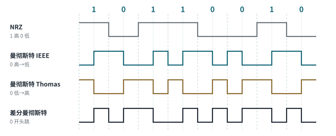

<!-- 计算机网络 / 第 2 章 数据通信技术 -->
# 第 3 课　编码调制、多路复用与交换技术

> 2026-09-21（周一）· 理论课 · 教材 2.3.2 数据编码和调制技术、2.3.3 多路复用、2.4 数据交换技术

## 一、随堂题

1. ARPANET 采用的是 **分组交换**
2. Internet **不属于任何一个单独的国家或组织**
3. 计算机网络最本质的功能是 **资源共享**

## 二、传输方式

| 方式 | 含义 |
|---|---|
| 基带传输 | 直接传输数字信号（不调制），如以太网 |
| 频带传输 | 把数字信号调制到载波上传输，如电话线 Modem |
| 宽带传输 | 一条介质上划分多个频带同时传多路信号 |

> **易错点**
> 课件里“线路不认识 0 和 1，所以数字数据必须转换成模拟波形”是过度简化。以太网就是数字数据经过**线路编码**后直接以**基带**数字信号传输，并不需要调制成模拟载波。

## 三、模拟调制：ASK / FSK / PSK

| 调制 | 改变载波的什么 | 记忆 |
|---|---|---|
| ASK 幅移键控 | **幅度** | 声音大小 |
| FSK 频移键控 | **频率** | 音调高低 |
| PSK 相移键控 | **相位** | 波形起点 |

## 四、数字编码：NRZ、曼彻斯特、差分曼彻斯特

*图 3-1　同一比特串的四种波形（虚线是位边界，浅线是位中间；差分曼彻斯特假设起始为低电平）*

| 编码 | 看哪里 | 0 | 1 |
|---|---|---|---|
| NRZ | 整个位周期的电平 | 低 | 高 |
| 曼彻斯特（IEEE 802.3） | 位**中间**跳变方向 | 高→低 | 低→高 |
| 曼彻斯特（G.E. Thomas） | 位**中间**跳变方向 | 低→高 | 高→低 |
| 差分曼彻斯特 | 位**开始处**有没有跳变 | 有跳变 | 无跳变 |

- **曼彻斯特**：每位中间必有跳变，接收方用它同步时钟，所以是**自同步编码**；代价是**带宽为 NRZ 的 2 倍**。10 Mbit/s 以太网使用
- **差分曼彻斯特**：位中间的跳变只用来同步，**数据看位开始处跳不跳**；令牌环（802.5）使用

> **易错点**
> G.E. Thomas 和 IEEE 802.3 两种约定**正好相反**；差分曼彻斯特也有教材把“有跳变”定为 1。课上就出现过“书上的规则和老师说的相反”。**考试以题目给的定义或老师口径为准**，答题时写一句“按 0 = 高→低 约定”最稳。（老师用哪种约定目前**未确认**）

## 五、PCM 脉冲编码调制

*图 3-2　PCM：采样 → 量化 → 编码*

- **采样**：采样频率 ≥ 信号最高频率的 2 倍（采样定理）。话音最高约 4 kHz，所以采样 8 kHz
- **量化**：把采样值归到有限个等级。**N 个等级需要 log₂N 位**：8 级要 3 位，16 级要 4 位，256 级要 8 位
- **编码**：每个量化值用二进制表示

> **考试主线**
> 电话 PCM：**8000 次/秒 × 8 bit = 64 kbit/s**，这就是一路数字话音的速率，也是后面 ISDN B 信道、E1 时隙的速率。

> **补充**
> 与“量化等级”相关的另一个常考公式是**奈奎斯特定理**：无噪声信道最大速率 = 2 × 带宽 × log₂（信号等级数）。例：8 kHz 无噪声信道、8 级信号 → 2 × 8k × 3 = **48 kbit/s**（题目里给的“每秒采样 24k 次”是干扰条件）。

## 六、多路复用

| 技术 | 原理 | 例子 |
|---|---|---|
| FDM 频分复用 | 不同用户占不同**频段** | 广播电台、有线电视 |
| TDM 时分复用 | 不同用户轮流占用**时隙** | E1：32 个时隙 × 64 kbit/s = 2.048 Mbit/s |
| WDM 波分复用 | 一根光纤里传多个**波长** | 光纤骨干网 |
| CDMA 码分复用 | 不同用户用不同**码片序列**，同时同频 | 3G 移动通信 |

**CDMA 与伪随机码**：每个用户分到一个码片序列；1 bit 展开成多个 chip 发送；接收方用对应的码做**相关运算**，只提取出自己的信号。伪随机码看起来随机，其实是**可以重复生成的确定序列**，收发双方能生成同样的码。

## 七、三种数据交换方式

| 方式 | 过程 | 特点 |
|---|---|---|
| 电路交换 | 建立连接 → 传数据 → 释放连接 | 通信期间**独占**电路，时延固定；建立慢、利用率低（打电话） |
| 报文交换 | 整个报文**存储转发** | 不用建连接；报文大时节点存储和时延都大 |
| 分组交换 | 切成小分组，逐个存储转发 | 线路共享、利用率高，分组可**流水线**并行传输；时延不固定 |

> **考试主线**
> 第 12 课会在广域网里再讲一次这三种方式，口诀：**专线买稳定、电路交换买实时、分组交换买便宜**。

## 八、本课小结

1. ASK / FSK / PSK 分别改变幅度、频率、相位
2. 曼彻斯特看中间跳变方向，差分曼彻斯特看开头跳不跳；两种约定方向相反
3. PCM：8 kHz × 8 bit = 64 kbit/s
4. FDM 分频、TDM 分时、WDM 分波长、CDMA 分码
