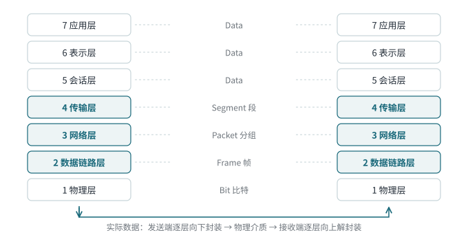

<!-- 计算机网络 / 第 3 章 计算机网络体系结构 -->
# 第 4 课　网络协议与 OSI 参考模型

> 2026-09-24（周四）· 理论课 · 教材 3.1、3.2

## 一、网络协议的三要素

| 要素 | 规定什么 | 以 TCP 建立连接为例 |
|---|---|---|
| **语法** | 数据和控制信息的**格式、结构** | SYN 报文各字段的位置和长度 |
| **语义** | 各字段**是什么意思**、收到后**做什么动作** | SYN 置 1 表示“请求建立连接” |
| **同步（时序）** | 事件发生的**顺序** | 必须 SYN → SYN+ACK → ACK |

> **记忆口诀**
> 语法管“长什么样”，语义管“什么意思”，同步管“先后顺序”。

## 二、为什么要分层

- 把复杂问题拆成若干小问题，每层只关心自己的任务
- 层与层之间通过**接口**提供**服务**，某一层换实现，不影响其他层
- 便于标准化、分工开发和**分层排障**

几个术语：**实体**（每层中活动的软硬件）、**对等实体**（不同主机上同一层的实体）、**协议**（对等实体之间的规则，水平方向）、**服务**（下层给上层提供的功能，垂直方向）。

## 三、OSI 七层模型

| 层 | 名称 | 主要功能 | PDU |
|---|---|---|---|
| 7 | 应用层 | 为应用程序提供网络服务 | Data / Message |
| 6 | 表示层 | 数据格式转换、加密、压缩 | Data |
| 5 | 会话层 | 建立、管理、终止会话 | Data |
| 4 | 传输层 | 端到端可靠传输、流量控制 | **Segment 段** |
| 3 | 网络层 | 路由选择、逻辑寻址 | **Packet 分组** |
| 2 | 数据链路层 | 成帧、物理寻址、差错检测 | **Frame 帧** |
| 1 | 物理层 | 比特流传输、电气机械特性 | **Bit 比特** |

> **记忆口诀**
> 从下往上：**物、数、网、传、会、表、应**。

## 四、封装与解封装

*图 4-1　同层之间是逻辑通信，数据实际沿“下—横—上”走*

- **发送端**：数据逐层向下，每层加上本层控制信息（首部，链路层还有尾部），形成本层 PDU
- **接收端**：逐层向上，每层去掉对应的控制信息，交给上层
- **同层通信是逻辑上的**：A 的传输层“好像”直接在和 B 的传输层对话，实际数据要先下到物理层，经过介质，再上到对方的传输层，两者并不矛盾

> **联系实际**
> Wireshark 里一个包展开后从上到下是 Frame → Ethernet II → IPv4 → TCP/ICMP，就是封装层次的直接体现（第 11 课实验看到）。

## 五、OSI 与 TCP/IP：两种“标准”

| | OSI | TCP/IP |
|---|---|---|
| 性质 | 法定标准（de jure），国际标准化组织制定 | **事实标准（de facto）**，靠实际部署成为主流 |
| 现状 | 协议体系没有普及 | 互联网实际使用的体系 |

OSI 协议体系没成为主流的原因：出得晚（TCP/IP 已经大规模部署）、制定周期长、缺乏商业驱动、协议复杂、实现效率低、层次划分不尽合理（会话层、表示层功能少，部分功能重复）。

> **易错点**
> “OSI 失败了”只是说 **OSI 协议体系**没能取代 TCP/IP，**OSI 参考模型**仍然是教学、描述网络体系和分层排障的通用语言，并不是没有价值。OSI 是**参考模型**，不是一个能直接运行的协议。

## 六、本课小结

1. 协议三要素：语法、语义、同步
2. OSI 七层及各层 PDU：段、分组、帧、比特
3. 封装向下加头，解封装向上去头；同层逻辑通信
4. OSI 是法定标准，TCP/IP 是事实标准
