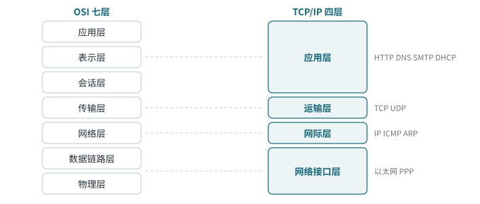
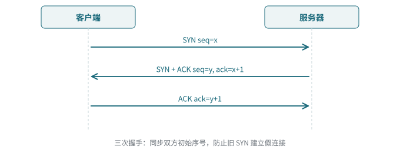
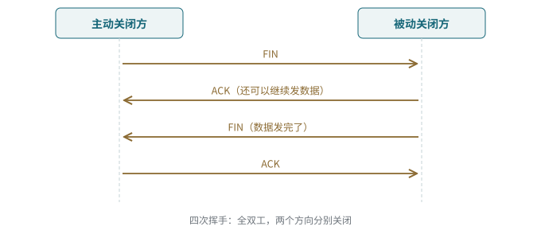

<!-- 计算机网络 / 第 3 章 计算机网络体系结构 -->
# 第 5 课　TCP/IP 参考模型、TCP 与 UDP

> 2026-10-08（周四）· 理论课 · 教材 3.3.1–3.3.3、3.4.1

## 一、TCP/IP 四层模型

*图 5-1　OSI 七层与 TCP/IP 四层的对应关系*

| 层 | 主要协议 | 作用 |
|---|---|---|
| 应用层 | HTTP、DNS、SMTP、DHCP、SNMP、TELNET、RIP | 面向用户的各种应用 |
| 运输层 | **TCP、UDP** | 端到端通信，用**端口**区分应用 |
| 网际层 | **IP**、ICMP、ARP、RARP、IGMP | 编址、路由、分片重组、首部检查 |
| 网络接口层 | 以太网、PPP 等 | 把 IP 数据报交给具体网络传输 |

> **易错点**
> “IP 不可靠”指的是 IP **不保证交付、不保证顺序、不负责重传**，不是完全不检错：IPv4 有**首部校验和**，但**只校验首部、不校验数据**；IPv6 干脆取消了首部校验和。

## 二、TCP

面向连接、可靠的字节流：序号、确认、超时重传、流量控制（滑动窗口）、拥塞控制。

*图 5-2　三次握手*

**为什么要第三次握手？** 服务器要确认客户端收到了自己的 SYN+ACK，双方的初始序号才算都同步了；同时防止网络里**延迟到达的旧 SYN** 让服务器建立一个没人用的“假连接”。

*图 5-3　四次挥手*

**为什么通常是四次？** TCP 是**全双工**的，两个方向要分别关闭：被动方收到 FIN 后可以先回 ACK，自己的数据发完再发 FIN。若 ACK 和 FIN 能一起发，就会合并成三次。

## 三、UDP

| 特点 | 说明 |
|---|---|
| 无连接 | 不握手，直接发 |
| 不可靠 | 不确认、不重传、不保证顺序 |
| 首部固定 **8 B** | 源端口、目的端口、长度、校验和 |
| 保留报文边界 | 发一个报文，对方就收一个完整报文 |
| 支持广播和组播 | TCP 只能一对一 |
| 无流量控制和拥塞控制 | 由应用自己负责 |

典型应用：**DNS、DHCP、TFTP、VoIP、直播**，以及 QUIC（HTTP/3）、WireGuard。

## 四、TCP 与 UDP 对比（3.3.2）

| 对比项 | TCP | UDP |
|---|---|---|
| 连接 | 面向连接 | 无连接 |
| 可靠性 | 可靠（确认、重传、排序） | 不可靠 |
| 首部 | 20–60 B | 8 B |
| 传输单位 | 字节流 | 报文 |
| 流量/拥塞控制 | 有 | 无 |
| 通信方式 | 一对一 | 一对一、一对多、多对多 |
| 典型应用 | HTTP、SMTP、FTP、SSH | DNS、DHCP、视频、语音 |

> **工程现实**
> “UDP 比 TCP 快”是简化说法：UDP 只是协议机制更轻，实际速度要看应用怎么用。QUIC 就是在 UDP 上**重新实现**了可靠传输和拥塞控制。另外“TCP 可靠”只保证字节流送到对端，不代表应用层业务一定成功。

## 五、OSI 与 TCP/IP 的比较（3.3.3）

| | OSI | TCP/IP |
|---|---|---|
| 层数 | 7 层 | 4 层 |
| 先有什么 | 先有模型，后有协议 | 先有协议，后总结出模型 |
| 地位 | 法定标准，理论完整 | 事实标准，互联网实际使用 |
| 网络层 | 支持面向连接和无连接 | 只有无连接（IP） |

## 六、IP 地址入门（3.4.1）

- IP 地址是**网络层逻辑地址**，可以随网络位置改变；MAC 地址是**链路层物理地址**，标识网卡
- IPv4 地址 32 位，分 A、B、C 等类；`127.0.0.0/8` 是**回环地址**
- 下节课细讲点分十进制与二进制换算

> **易错点**
> 教材说“MAC 地址固化在网卡中，不能修改”是简化：网卡确实有出厂 MAC，但操作系统可以修改对外使用的 MAC，虚拟机和容器用虚拟 MAC，手机连 Wi-Fi 还会做 **MAC 随机化**。

> **补充**
> SYN 和 TLS 的 ClientHello 不在同一层：SYN 是 TCP（传输层）建立连接，ClientHello 是 TCP 连上之后 TLS 协商加密参数。

## 七、本课小结

1. TCP/IP 四层：应用、运输、网际、网络接口
2. TCP 三次握手、四次挥手的原因
3. UDP 首部 8 B，无连接，支持广播组播
4. IP 不可靠 ≠ 不检错；IPv4 首部校验和只管首部
