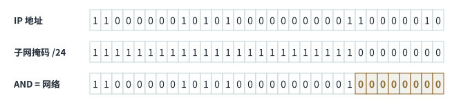
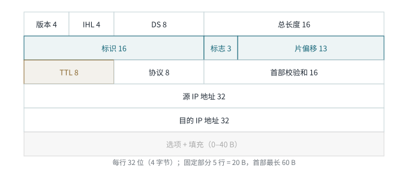

<!-- 计算机网络 / 第 3 章 3.4 IP 地址 -->
# 第 6 课　IPv4 地址、子网掩码与子网划分

> 2026-10-12（周一）· 理论课 · 教材 3.4

## 一、IPv4 地址的表示

- 32 位 = 4 字节，每 8 位一段，写成**点分十进制**，每段 0–255
- 二进制换算用权值：**128 64 32 16 8 4 2 1**

例：`192` = 128 + 64 = `11000000`；`168` = 128 + 32 + 8 = `10101000`

## 二、分类地址（历史体系）

| 类 | 首位 | 第一段范围 | 默认掩码 | 用途 |
|---|---|---|---|---|
| A | 0 | 1–126 | /8 | 大型网络 |
| B | 10 | 128–191 | /16 | 中型网络 |
| C | 110 | 192–223 | /24 | 小型网络 |
| D | 1110 | 224–239 | — | 组播 |
| E | 1111 | 240–255 | — | 保留 |

`127.0.0.0/8` 是**回环地址**（本机），不分配给主机。

**RFC 1918 私有地址**：`10.0.0.0/8`、`172.16.0.0/12`（172.16–172.31）、`192.168.0.0/16`

> **工程现实**
> A/B/C 分类是历史体系，现在路由和地址分配都用 **CIDR（无类域间路由）**，前缀长度可以是任意值。所以 VPS 拿到的 `/22`、`/26` 之类的前缀和“分类默认掩码”对不上很正常。考试按分类答，实际按 CIDR 理解。

> **易错点**
> “内网地址”不等于“RFC 1918 私有地址”。某校园网使用 `172.204.0.0/16`，它在校内当内网用，但 **172.204 不在 172.16–172.31 范围内，不是私有地址**。

## 三、子网掩码与 CIDR

- 子网掩码 32 位，**连续的 1 是网络位，连续的 0 是主机位**
- CIDR 写法：`/24` 表示前 24 位是网络位，即 `255.255.255.0`
- **IP AND 掩码 = 网络地址**；两个 IP 和同一掩码 AND 后结果相同，就在同一子网

*图 6-1　192.168.1.130/24：与掩码按位与，主机位清零得到网络地址 192.168.1.0*

| 计算项 | 方法 | 192.168.1.130/24 |
|---|---|---|
| 网络地址 | 主机位全 0 | 192.168.1.0 |
| 广播地址 | 主机位全 1 | 192.168.1.255 |
| 可用主机 | 2^主机位 − 2 | 2⁸ − 2 = 254 |
| 主机范围 | 网络地址 +1 到 广播地址 −1 | .1 – .254 |

例：校园网 `172.204.x.x/16`，网关 `172.204.0.1` → 网络地址 `172.204.0.0`，广播地址 `172.204.255.255`。

## 四、子网划分

**从主机位的高位借位作为子网位**，每借 1 位，子网数翻倍、每个子网的地址数减半。

例：把 `192.168.1.0/24` 划分为 4 个子网 → 借 2 位，变成 `/26`，**块大小 = 256 − 192 = 64**

| 子网 | 网络地址 | 主机范围 | 广播地址 |
|---|---|---|---|
| 1 | 192.168.1.0/26 | .1 – .62 | .63 |
| 2 | 192.168.1.64/26 | .65 – .126 | .127 |
| 3 | 192.168.1.128/26 | .129 – .190 | .191 |
| 4 | 192.168.1.192/26 | .193 – .254 | .255 |

> **记忆口诀**
> 常用掩码最后一段：/25 = 128，/26 = 192，/27 = 224，/28 = 240，/29 = 248，/30 = 252。**块大小 = 256 − 掩码最后一段**。

> **补充**
> `/32` 表示**单个地址**（主机路由），子网里只有它自己；`/31` 常用于点到点链路（两端各一个地址，不需要网络地址和广播地址）。

## 五、IPv4 数据报首部（前半部分）

*图 6-2　IPv4 首部格式（RFC 791）*

- IPv4 数据报 = **首部 + 数据**；首部固定 **20 B**，加选项和填充最长 **60 B**
- **版本**（4 位）：IPv4 填 4
- **IHL 首部长度**（4 位）：单位是 **4 字节**，取值 5–15，所以首部 20–60 B
- **DS**（8 位）：区分服务（QoS），后 2 位用作 ECN
- **总长度**（16 位）：首部 + 数据，最大 65535 B
- **标识**（16 位）：同一数据报的各个分片标识相同。**它只用来识别分片，不是 TCP 那种序号**

> **易错点**
> IHL 填的是“几个 4 字节”：IHL = 5 → 20 B，IHL = 15 → 60 B。

## 六、本课小结

1. 点分十进制 ↔ 二进制，权值 128…1
2. A/B/C 类与 RFC 1918；内网 ≠ 私网
3. IP AND 掩码 = 网络地址；网络地址主机位全 0，广播地址全 1
4. 子网划分：借位，块大小 = 256 − 掩码末段
5. 首部 20–60 B，IHL × 4 = 首部长度
