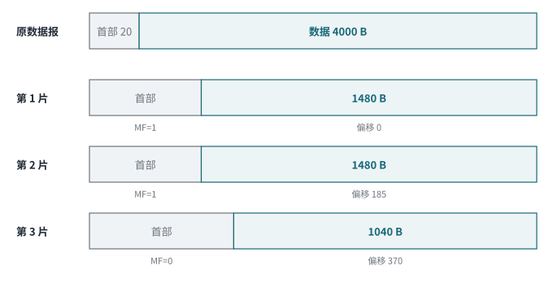

<!-- 计算机网络 / 第 3 章 3.4 IP 地址 -->
# 第 7 课　IPv4 分片、TTL 与首部校验，IPv6 入门

> 2026-10-14（周三）· 理论课（在机房上）· 教材 3.4

## 一、分片相关的三个字段

| 字段 | 位数 | 作用 |
|---|---|---|
| 标识 Identification | 16 | 同一个原始数据报的所有分片**标识相同**，接收方据此把它们拼回去 |
| 标志 Flags | 3 | 保留位、**DF**（=1 不允许分片）、**MF**（=1 后面还有分片） |
| 片偏移 Fragment Offset | 13 | 本片数据在原数据中的位置，**单位是 8 字节** |

> **易错点**
> 课件把三个字段加起来写成 28 bit，**正确是 16 + 3 + 13 = 32 bit**，正好是首部的一整行。

## 二、分片例题

**题目**：一个 IPv4 数据报，**数据部分 4000 B**，首部 20 B，要经过 MTU = 1500 B 的链路，怎么分片？

1. 每片最多能装的数据：1500 − 20 = **1480 B**（1480 ÷ 8 = 185，正好是 8 的倍数）
2. 4000 = 1480 + 1480 + 1040，分成 3 片

*图 7-1　4000 B 数据分成三片*

| 分片 | 数据长度 | 总长度 | 片偏移 | MF |
|---|---|---|---|---|
| 1 | 1480 | 1500 | 0 | 1 |
| 2 | 1480 | 1500 | 1480 ÷ 8 = **185** | 1 |
| 3 | 1040 | 1060 | 2960 ÷ 8 = **370** | 0 |

三片的**标识相同**，DF = 0。

> **易错点**
> ① 课件文字写“4000 字节数据报”，图里写“4000 字节数据部分”；按计算过程，4000 是**数据部分**，原数据报总长 4020 B。② “每个分片长度必须是 8 的整数倍”要加限定：**除最后一片外**，各片的**数据部分**必须是 8 的倍数，因为偏移以 8 字节为单位。③ 偏移 = 前面所有分片数据长度之和 ÷ 8。

## 三、TTL、协议、首部校验和

| 字段 | 位数 | 说明 |
|---|---|---|
| **TTL** 生存时间 | 8 | 每经过一个路由器减 1，**减到 0 就丢弃**并回 ICMP 超时，防止数据报在路由环路里无限循环 |
| **协议** | 8 | 上层是什么：**ICMP = 1，TCP = 6，UDP = 17** |
| **首部校验和** | 16 | **只校验首部**；每一跳 TTL 改变，路由器都要**重新计算** |

> **联系实际**
> traceroute / mtr 就是利用 TTL：依次发 TTL = 1、2、3… 的包，每一跳路由器把 TTL 减到 0 时回一个 ICMP 超时，就知道路径上每一跳是谁。

> **补充**
> 课件某页首部字段汇总漏了 IHL、DS/ECN 和首部校验和，复习时以完整首部图（第 6 课图 6-2）为准。

## 四、IPv6 入门

- 地址 **128 位**，写成 **8 组十六进制**，每组 16 位，用冒号分隔
- 基本首部**固定 40 B**，其他功能放在**扩展首部**里
- 两条压缩规则：
  1. 每组的**前导 0 可以省略**：`0db8` → `db8`
  2. **连续的全 0 组**可以用 `::` 代替，但**一个地址里只能用一次**

例：`2001:0db8:0000:0000:0000:ff00:0042:8329` → `2001:db8::ff00:42:8329`

> **工程现实**
> IPv6 有 SLAAC 自动配置，但不等于“IPv6 都不需要 DHCP”（还有 DHCPv6）；IPv6 也不是“天生就安全”，IPsec 在 IPv6 里同样是可选的。

## 五、本课小结

1. 标识 16 + 标志 3 + 片偏移 13 = 32 位；偏移单位 8 B
2. 分片：每片数据 = MTU − 首部，偏移 = 累计数据 ÷ 8，最后一片 MF = 0
3. TTL 防环路；协议号 ICMP 1、TCP 6、UDP 17；校验和只管首部
4. IPv6：128 位，前导 0 省略，`::` 只能用一次
