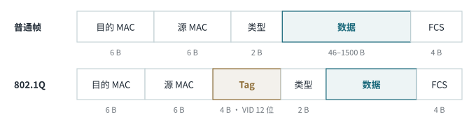

<!-- 计算机网络 / 第 3–4 章 -->
# 第 8 课　IPv6 过渡、VLAN 与局域网基础、CSMA/CD

> 2026-10-19（周一）· 理论课 · 教材 3.4（续）、第 4 章 4.1 局域网组网技术（本节课中途进入第 4 章）

## 一、IPv6 续

- 常见前缀：`/64` 是一个标准子网（后 64 位给主机）；`/128` 是单个地址
- 压缩练习：`2001:db8:0:0:1:0:0:1` → `2001:db8::1:0:0:1`（`::` 只能替换**一处**连续 0，另一处只能写成 `0:0`）
- 可以在 IPv6 地址里嵌入 IPv4，写成 `::ffff:192.168.1.1` 这种混合形式

### IPv6 过渡技术

| 技术 | 原理 |
|---|---|
| **双栈** Dual Stack | 设备同时运行 IPv4 和 IPv6 两套协议栈 |
| **隧道** Tunnel | 把 IPv6 包封装在 IPv4 包里穿过 IPv4 网络；6in4 的 IPv4 协议号是 **41** |
| **NAT-PT** | 在 IPv4 和 IPv6 之间做地址和协议转换 |

> **工程现实**
> NAT-PT 是老方案，已被废弃；现在常用 **NAT64 + DNS64** 让纯 IPv6 主机访问 IPv4 网站。HE Tunnelbroker 提供的免费 IPv6 隧道用的就是 6in4。

## 二、VLAN

- **虚拟局域网**：在交换机上按逻辑而不是按物理位置分组，**每个 VLAN 是一个独立的广播域**
- VLAN 是**二层**概念，IP 子网是**三层**概念；实际设计中通常**一个 VLAN 对应一个子网**；**不同 VLAN 之间通信必须经过三层**（路由器或三层交换机）
- **802.1Q**：在以太网帧的源 MAC 后插入 **4 B 标签**，其中 **VID 12 位**（最多 4094 个可用 VLAN）

*图 8-1　802.1Q 在帧里插入 4 字节标签*

| 端口类型 | 用途 |
|---|---|
| **Access** | 接终端，只属于一个 VLAN，收发的帧不带标签 |
| **Trunk** | 交换机之间互联，承载多个 VLAN，帧带 802.1Q 标签 |

> **补充**
> 云上的 **VPC** 不是 VLAN：VLAN 在二层，VPC 是云里逻辑隔离的**三层私有网络**（自己的 CIDR、子网、路由表、安全策略）。**VPC Peering** 是把两个 VPC 用私网三层打通。

## 三、第 4 章　局域网技术

### 1. 局域网的定义、分类与组成

- 定义：**有限地理范围**内的计算机网络
- 分类维度：传输介质（有线 / 无线）、拓扑结构、介质访问控制方式、信息交换方式
- 组成：**硬件**（服务器 / 工作站、网卡、传输介质、互联设备）+ **软件**（网络操作系统、协议、网管软件、应用软件）

### 2. 局域网体系结构

局域网只对应 OSI 的**物理层和数据链路层**。物理层有**四大特性**：机械特性、电气特性、功能特性、过程（规程）特性。

数据链路层分成两个子层：

| 子层 | 特点 |
|---|---|
| **MAC** 介质访问控制 | 与具体介质和访问方式**有关**：CSMA/CD、CSMA/CA、令牌 |
| **LLC** 逻辑链路控制 | 与介质**无关**：建立、维护、释放逻辑链路，向上提供统一接口 |

### 3. IEEE 802 标准

| 标准 | 内容 |
|---|---|
| 802.1 | 体系结构、网络互联、管理（802.1Q 就在这里） |
| 802.2 | LLC |
| **802.3** | **以太网**（CSMA/CD） |
| **802.4** | **令牌总线** |
| **802.5** | **令牌环** |
| **802.11** | **无线局域网 WLAN**（CSMA/CA） |
| **802.15** | 无线个域网 WPAN（蓝牙） |
| **802.16** | 无线城域网（WiMAX） |

> **记忆口诀**
> 3 以太、4 令牌总线、5 令牌环、11 无线局域、15 个域、16 城域。

> **易错点**
> 教材说数据链路层“在不可靠的物理信道上实现可靠传输”，这是 HDLC 时代的说法。以太网只用 CRC **检错**、丢弃坏帧，**自己不重传**，可靠性交给上层（第 14 课还会讲这个设计取舍）。

## 四、CSMA/CD（载波监听多路访问 / 冲突检测）

*图 8-2　先听后发、边发边听、冲突停发、随机延迟后重发*

- **为什么两边都听到空闲还会冲突**：信号在线路上传播需要时间，A 发出的信号还没传到 B，B 听到的仍是空闲，于是也发了
- **争用期 2τ**（τ 为单程端到端传播时延）：最坏情况下，A 发出后要过 2τ 才能知道有没有冲突。所以一个帧的发送时间必须 ≥ 2τ，否则发完了还不知道冲突
- 经典 10 Mbit/s 以太网：争用期取 **51.2 μs = 512 bit 时间** → **最短帧 64 B**

### 二进制指数退避

1. 第 n 次冲突，取 **k = min(n, 10)**
2. 从 **{0, 1, …, 2^k − 1}** 中随机取一个 r
3. 等待 **r × 51.2 μs** 后重发
4. 连续冲突 **16 次**仍不成功，放弃并报错

> **工程现实**
> CSMA/CD 是共享介质（总线、Hub）时代的机制。今天的以太网是**交换机 + 全双工**，根本没有冲突，用不到 CSMA/CD。

## 五、本课小结

1. 双栈、隧道（6in4 协议号 41）、NAT-PT（现用 NAT64）
2. VLAN 隔离广播域；802.1Q 标签 4 B、VID 12 位；Access / Trunk
3. 局域网 = 物理层 + 数据链路层（MAC + LLC）
4. IEEE 802.3 / 4 / 5 / 11 / 15 / 16
5. CSMA/CD 四步、争用期 2τ、最短帧 64 B、退避 k = min(n,10)、16 次放弃
