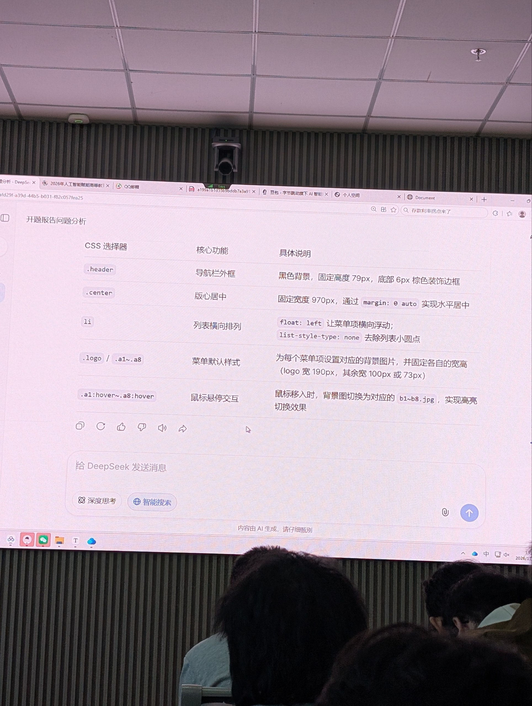

# Class 13：浮动 float 与导航栏案例

Class 12 结尾提到：块级元素从上到下排，行内元素从左到右排，这叫**普通流**，“浮动 float 下节课讲”。本节课讲 float，并用一个**圣华家具导航栏（header）**案例把它用起来。

下面所有“实测”数字，都是把课堂代码放进 Chromium 里渲染量出来的（窗口宽 1200px，浏览器默认 `body` 外边距 8px）。

---

## 一、先回顾：普通流

- 块级元素（`div`、`p`、`li`）：**独占一行**，从上往下排
- 行内元素（`span`、`a`）：**同一行**从左往右排，放不下才换行
- 想让几个块级元素**横着排**，普通流做不到 → 用浮动

---

## 二、浮动 `float`

| 取值 | 作用 |
| --- | --- |
| `left` | 向左靠拢 |
| `right` | 向右靠拢 |
| `none` | 不浮动（默认值） |

课上让 DeepSeek 总结的要点：

| 要点 | 说明 |
| --- | --- |
| 作用 | 让元素向左或向右靠拢，常用于**图文环绕、多栏布局** |
| 取值 | `left` / `right` / `none`（默认） |
| 脱离文档流 | **不占原来的位置**，但文字会环绕它 |
| 高度塌陷 | 父元素没设高度时，子元素全部浮动 → 父元素高度变成 0 |

课堂 DeepSeek 页面的截图：



> 截图里那张表是对案例二（header）每条 CSS 的解释，下面第四节会逐条对照。

---

## 三、案例一：`class13.html`（块元素 vs 行元素）

```html
<style>
  div{
    float: left;            /* 所有 div 都向左浮动 */
    width: 300px;
    height: 160px;
    background-color: #ff0000;
    margin: 10px;           /* 间距 */
    text-align: center;     /* 水平居中 */
    line-height: 160px;     /* 行高 = 盒子高度 → 垂直居中 */
    font-size: 40px;
    color: #fff;
  }
  .r1{ float: right; }      /* 第三个 div 单独改成向右 */
</style>

<p>这是三个块元素</p>
<div>div</div>
<div>div</div>
<div class="r1">div</div>

<p>这是三个行元素</p>
<span>span</span>
<span>span</span>
<span>span</span>
```

### 1. 逐条分析

- **`div { float: left; }`**：页面里所有 `div` 都向左浮动，所以前两个红块**横着并排**。
- **`.r1 { float: right; }`**：第三个 `div` 同时命中 `div` 和 `.r1`，两条规则的 `float` 冲突。**类选择器优先级高于标签选择器**，所以 `.r1` 赢，它靠到**最右边**。
- **`text-align: center` + `line-height: 160px`**：Class 12 的老办法，`line-height` 等于盒子高度，一行字就在盒子里上下居中。
- **`margin: 10px`**：每个红块左右各 10px，实际占位 `300 + 10 + 10 = 320px`。
- 三个 `span` 没有设置 `float`，所以**不受 `div` 规则影响**，仍然是行内元素。

### 2. 实测结果（窗口宽 1200px）

| 元素 | x | y | 说明 |
| --- | --- | --- | --- |
| 第 1 个 div | 18 | 66 | 靠左 |
| 第 2 个 div | 338 | 66 | 紧挨第 1 个（相隔 20px = 两边 margin 之和） |
| 第 3 个 div（`.r1`） | 882 | 66 | 靠右，右边缘 = 1182 = 1200 − 8 − 10 |
| 第 2 个 `<p>` | 8 | 56 | **和红块在同一高度**，没被挤到红块下面 |
| 第 1 个 `<span>` | 648 | 96 | 夹在第 2、3 个红块**中间的空隙**里 |

关键现象：**第二段文字 `这是三个行元素` 和三个 `span` 没有跑到红块下面，而是钻进了中间的空地。** 这就是“脱离文档流：不占原位置，但文字会环绕它”：

- 红块脱离了普通流，`<p>` 就好像它们不存在，直接从第一个 `<p>` 下面开始排（所以 y=56 比红块的 y=66 还靠上）；
- 但**文字（行内内容）会主动避开浮动盒子**，所以挤在中间。

### 3. 窗口变窄会怎样

把窗口缩到 800px：第 1、2 个红块还在第一行，**第 3 个放不下，掉到下一行**（y=246），仍然靠右（x=482）。

```
一行放得下的最小宽度 = 3 × 320 + body 左右各 8px = 976px
```

窗口小于这个宽度，最后一个浮动元素就会**换行**。

---

## 四、案例二：`header.html`（圣华家具导航栏）

效果：黑色导航条，左边是 logo，右边 8 个菜单项，鼠标移上去**图片切换**（高亮）。

### 1. 结构

```html
<div class="header">          <!-- 黑色通栏 -->
  <div class="center">        <!-- 980px 版心，居中 -->
    <li class="logo"></li>
    <li class="a1"></li>
    <li class="a2"></li>
    ...
    <li class="a8"></li>
  </div>
</div>
```

三层关系：`header`（通栏背景）→ `center`（居中的版心）→ `li`（logo 和 8 个菜单）。

### 2. 逐条分析 CSS（对照截图里的表）

| 选择器 | 作用 | 说明 |
| --- | --- | --- |
| `.header` | 导航栏外框 | 黑色背景，高 79px，底部 6px 棕色边框 |
| `.center` | 版心居中 | 固定宽度 980px，`margin: 0 auto` 水平居中 |
| `li` | 列表横向排列 | `float: left` 让菜单项横着排；`list-style: none` 去掉圆点 |
| `.logo` / `.a1~.a8` | 菜单默认样式 | 每项一张背景图，并固定宽高 |
| `.a1:hover~.a8:hover` | 鼠标悬停 | 背景图换成 `b1~b8.jpg` |

```css
.header{
  height: 79px;
  background-color: #000;
  border-bottom: 6px solid #644226;   /* 棕色装饰边 */
}
.center{
  width: 980px;
  height: 79px;
  margin: 0 auto;                     /* 左右 auto → 水平居中 */
}
li{
  float: left;                        /* 横排 */
  list-style: none;                   /* 去圆点 */
}
.logo{ background-image: url(./images/logo.jpg); height: 79px; width: 190px; }
.a1  { background-image: url(./images/a1.jpg);   width: 73px;  height: 79px; }
.a2  { background-image: url(./images/a2.jpg);   width: 100px; height: 79px; }
/* a3 ~ a8 同 a2 */
.a1:hover{ background-image: url(./images/b1.jpg); width: 73px; height: 79px; }
/* a2:hover ~ a8:hover 同理，换成 b2 ~ b8 */
```

### 3. 几个要点

**① 为什么 `.center` 能居中？**
`margin: 0 auto` 要生效，块级元素必须有**确定的宽度**。这里写了 `width: 980px`，浏览器就把左右剩余空间平分。实测 1200px 窗口里，`.center` 的 x = 110，右边留 110 → 左右对称。

**② 宽度加起来够不够？**

```
logo 190 + a1 73 + (a2~a8 共 7 个 × 100) = 190 + 73 + 700 = 963px
980 − 963 = 17px 剩余
```

963 ≤ 980，所以 9 个 `li` 能排进同一行。**如果版心宽度小于 963px，最后一个就会掉下去。** 实测把 `.center` 改成 900px：`a8` 掉到了第二行（x=150，y=87），导航栏就“断”了。这就是浮动元素**一行放不下就换行**的特性。

**③ 为什么 `li` 里什么字都没有，却能看到菜单？**
菜单文字是**画在图片里**的。`li` 只负责占出一块 `宽 × 79px` 的区域，再用 `background-image` 把图片铺进去。图片尺寸和盒子尺寸一致（实测 logo 是 190×79，`a1` 是 73×79，其余 100×79），所以刚好铺满，不重复也不裁切。

**④ hover 为什么能“高亮”？**
`.a1` 用 `a1.jpg`（平常状态），`.a1:hover` 换成 `b1.jpg`（高亮状态）。鼠标一移上去，浏览器就把背景图换掉。这和 Class 12 竖向导航里“hover 时换背景图”是同一个套路，区别只是这次改成了横排。

**⑤ 为什么两层都写 `height: 79px`？**
这就是下一节的“高度塌陷”。

---

## 五、高度塌陷（本案例的重点）

**浮动元素脱离了文档流，父元素“看不见”它们，不会被它们撑开。** 所以：父元素没设高度，里面的子元素又全是浮动 → 父元素高度 = 0。

用案例二直接验证（把 `.header` 和 `.center` 的 `height: 79px` 都删掉）：

| | `.header` 高度 | `.center` 高度 | 看到的效果 |
| --- | --- | --- | --- |
| 原代码（写了高度） | **85px**（79 内容 + 6 边框） | **79px** | 黑色导航条正常显示 |
| 删掉两处 height | **6px**（只剩边框） | **0px** | 黑条消失，只剩一条 6px 棕线 |

结论：案例里 `.center` 和 `.header` 都写 `height: 79px`，**就是为了避免高度塌陷**。

> 另外，`.header` 的 `height: 79px` 只算内容区；加上 `border-bottom: 6px`，总高度是 85px。

---

## 六、易错点

1. **PPT/截图写的宽度和代码不一致**：DeepSeek 的表里写 `.center` 宽 970px，但代码里是 `980px`。以代码为准（实测 980px）。
2. **`li` 的写法不规范**：代码里 `li` 直接放在 `div` 里面。HTML 规范要求 `li` 必须放在 `ul`（或 `ol`）里面，标准写法是 `div.center > ul > li`。课堂这样写浏览器照样能显示，但结构不标准。
3. **`:hover` 里重复写宽高是多余的**：`.a1:hover` 会继承 `.a1` 里的 `width` 和 `height`，只写 `background-image` 就够了。
4. **多个 class 重复的宽高可以合并**：`.a2 ~ .a8` 宽高相同，实际开发会把公共部分提取出来。
5. **调试小技巧**：课上的 `example.md` 里 `.center` 临时加了 `background-color: aqua`（青色），目的是看清版心盒子的范围；写完后注释掉（`header.html` 里就是注释状态）。
6. **hover 图第一次可能闪一下**：`b1~b8.jpg` 是鼠标第一次移上去才加载的。更成熟的做法是把正常/高亮两个状态拼成一张图（雪碧图），课上没讲，了解即可。
7. **老师还没讲的**：怎么解决高度塌陷（清除浮动）这节课没讲，等老师讲了再记。
