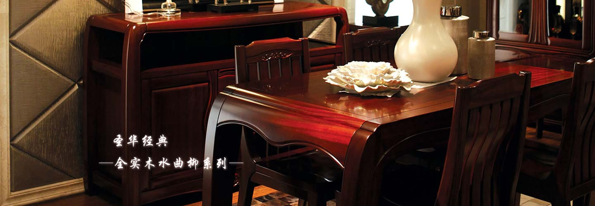

```html
<!DOCTYPE html>
<html lang="zh-CN">
<head>
  <meta charset="UTF-8">
  <title>Title</title>
  <style>
    /* header 样式*/
    .header{
      height: 79px;
      background-color: #000;
      border-bottom: 6px solid #644226;
    }
    .center{
      width: 980px;
      /*background-color: aqua;*/
      height: 79px;
      margin: 0 auto;
    }
    li{
      float: left;
      list-style: none;
    }
    .logo{
      background-image: url(../../sucai/images/logo.jpg);
      height: 79px;
      width: 190px;
    }
    .a1{
      background-image: url(../../sucai/images/a1.jpg);
      width: 73px;
      height: 79px;
    }
    .a2{
      background-image: url(../../sucai/images/a2.jpg);
      width: 100px;
      height: 79px;
    }
    .a3{
      background-image: url(../../sucai/images/a3.jpg);
      width: 100px;
      height: 79px;
    }
    .a4{
      background-image: url(../../sucai/images/a4.jpg);
      width: 100px;
      height: 79px;
    }
    .a5{
      background-image: url(../../sucai/images/a5.jpg);
      width: 100px;
      height: 79px;
    }
    .a6{
      background-image: url(../../sucai/images/a6.jpg);
      width: 100px;
      height: 79px;
    }
    .a7{
      background-image: url(../../sucai/images/a7.jpg);
      width: 100px;
      height: 79px;
    }
    .a8{
      background-image: url(../../sucai/images/a8.jpg);
      width: 100px;
      height: 79px;
    }

    .a1:hover{
      background-image: url(../../sucai/images/b1.jpg);
      width: 73px;
      height: 79px;
    }
    .a2:hover{
      background-image: url(../../sucai/images/b2.jpg);
      width: 100px;
      height: 79px;
    }
    .a3:hover{
      background-image: url(../../sucai/images/b3.jpg);
      width: 100px;
      height: 79px;
    }
    .a4:hover{
      background-image: url(../../sucai/images/b4.jpg);
      width: 100px;
      height: 79px;
    }
    .a5:hover{
      background-image: url(../../sucai/images/b5.jpg);
      width: 100px;
      height: 79px;
    }
    .a6:hover{
      background-image: url(../../sucai/images/b6.jpg);
      width: 100px;
      height: 79px;
    }
    .a7:hover{
      background-image: url(../../sucai/images/b7.jpg);
      width: 100px;
      height: 79px;
    }
    .a8:hover{
      background-image: url(../../sucai/images/b8.jpg);
      width: 100px;
      height: 79px;
    }


    /* footer 样式 */
    body{
      margin: 0;
    }
    .footer {
      margin-top: 12px;
      font-family: "Microsoft YaHei", "PingFang SC", Arial, sans-serif;
      font-size: 12px;
      color: #9F582C;
    }
    .footer p{
      margin: 0;
    }
    li{
      float: left;
      list-style: none;
    }
    .footer_top{
      height: 33px;
      background-color: #000000;
      line-height: 33px;
    }
    .footer_top a{
      color: #9F582C;
      text-decoration: none;
      margin-right: 6px;
    }
    .footer_top li{
      margin-right: 6px;
    }
    .footer_top_cen{
      width: 980px;
      margin: 0 auto;
    }
    .footer_top_cen_left{
      float: left;
    }
    .footer_top_cen_right{
      float: right;
      letter-spacing: 10px;
      margin-right: -10px;   /* 抵消最后一个字的字间距，让"金"贴齐右边 */
    }
    .footer_btm{
      height: 142px;
      background-color: #4A311B;
    }
    .footer_btm_cen{
      margin: 0 auto;
      width: 980px;
    }
    .footer_btm_cen_left{
      padding-top: 10px;
    }
    .footer_btm_cen_left div{
      float: left;
    }

    /* 左侧文字 */
    .footer_btm_cen_left_1{
      width: 461px;
      padding-top: 7px;
      font-weight: bold;
      white-space: nowrap;
    }
    .footer_btm_cen_left_1 p{
      line-height: 26px;
    }
    .footer_btm_cen_left_1 span{
      font-weight: normal;
    }

    /* 微信 */
    .footer_btm_cen_left_2{
      position: relative;
      box-sizing: border-box;
      width: 198px;
      padding-top: 11px;
    }
    .footer_btm_cen_left_2::after{      /* 竖线 */
      content: "";
      position: absolute;
      right: 0;
      top: 18px;
      width: 1px;
      height: 73px;
      background-color: #C9824A;
    }

    /* 微博 */
    .footer_btm_cen_left_3{
      padding-top: 11px;
      padding-left: 17px;
    }

    /* ===== 二维码白边问题（class14 遗留，class15 发现，此处已修复）=====
       现象：二维码四周白边很厚，像套了两层白框。
       原因：rw1.jpg / rw2.jpg 本身就是 90×90 的白色圆角卡片，自带约 4px 白色留白（二维码的静区，不能去掉）；
             原来的 .qr 又写了 background-color:#fff + border:2px solid #fff + border-radius:6px，
             而且宽高 88px，图片被 width:100% 缩成 84px → 白边叠了两层。
       解决：删掉 background-color、border、border-radius 三行，宽高改成图片原始尺寸 90px，图片原样显示。
       教训：套别人的 CSS 之前，先看图片本身长什么样；样式是"补"出来的，不是越多越好。 */
    .qr{
      width: 90px;
      height: 90px;                
      text-align: center;
      color: #bbbbbb;
      font-size: 12px;
    }
    .qr img {
      width: 100%;
      height: 100%;
      display: block;
    }
    .qr_text{
      margin-left: 8px;
      padding-top: 4px;
      white-space: nowrap;
    }
    .qr_text p{
      line-height: 26px;
    }
    .qr_text em{
      color: #ff0000;
      font-style: normal;
      font-weight: bold;
    }
    /*3.content部分*/
    .con_cen{
      width: 980px;
      margin: 0 auto;
    }
    .con_cen img{
      width: 980px;
    }
  </style>
</head>
<body>
<!-- ===== header（原样） ===== -->
<div class="header">
  <div class="center">
    <li class="logo"></li>
    <li class="a1"></li>
    <li class="a2"></li>
    <li class="a3"></li>
    <li class="a4"></li>
    <li class="a5"></li>
    <li class="a6"></li>
    <li class="a7"></li>
    <li class="a8"></li>

  </div>
</div>
<div class="content">
  <div class="con_cen">
    
  </div>

</div>

<div class="footer">
  <div class="footer_top">
    <div class="footer_top_cen">
      <ul class="footer_top_cen_left" style="margin:0;padding:0;">
        <li><a href="">首页</a>|</li>
        <li><a href="">关于圣华</a>|</li>
        <li><a href="">新闻中心</a>|</li>
        <li><a href="">产品中心</a>|</li>
        <li><a href="">圣华工艺</a>|</li>
        <li><a href="">特色服务</a>|</li>
        <li><a href="">招商加盟</a>|</li>
        <li><a href="">联系我们</a></li>
      </ul>
      <div class="footer_top_cen_right">
        百年圣华
        锻木成金
      </div>
    </div>

  </div>
  <div class="footer_btm">
    <div class="footer_btm_cen">
      <div class="footer_btm_cen_left">
        <div class="footer_btm_cen_left_1">
          <p>版权：北京圣华家具有限公司 <span>All Right Reserved</span></p>
          <p>电话： 010-80701888/80728598 &nbsp;&nbsp;招商专线：138-1117-3666</p>
          <p>地址：北京市昌平区沙河镇七里渠北村工业园区410号</p>
          <p>ICP备案编号：京ICP备1234567890号 &nbsp;&nbsp;技术支持：科诺威</p>
        </div>
        <div class="footer_btm_cen_left_2">
          <div class="qr"></div>
          <div class="qr_text">
            <p>请扫描左侧二维码</p>
            <p>关注圣华家具微信</p>
          </div>
        </div>
        <div class="footer_btm_cen_left_3">
          <div class="qr"></div>
          <div class="qr_text">
            <p>手机扫二维码关注官方微博</p>
            <p>点击“<em>圣华家具</em>”直接进入</p>
          </div>
        </div>
      </div>
    </div>
  </div>

</div>
</body>
</html>

```
